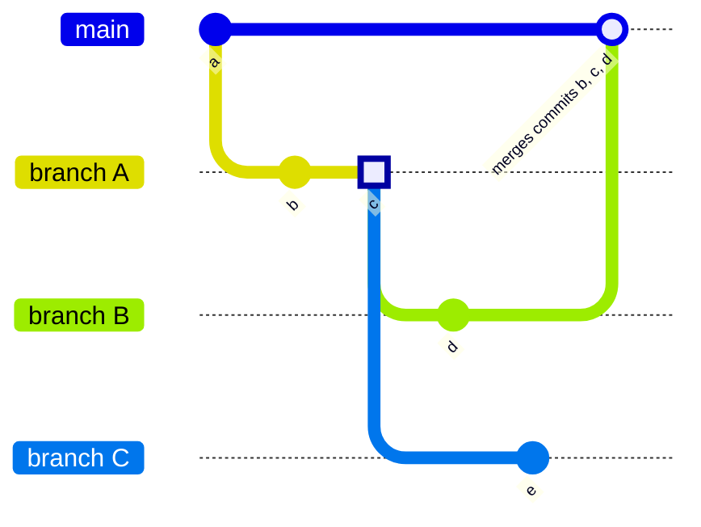



- 티어: Free, Premium, Ultimate
- 제공 서비스: GitLab.com, GitLab Self-Managed, GitLab Dedicated



브랜치는 팀의 개발 작업을 체계적으로 구성하고 분리합니다. 여러 사람이 동시에 다양한 기능을 작업할 때 브랜치는 변경 사항이 서로 충돌하는 것을 방지합니다. 각 브랜치는 새로운 기능을 구현하고, 버그를 수정하거나, 아이디어를 실험할 수 있는 독립된 작업 영역 역할을 합니다.

브랜치를 사용하면 팀은 다음을 수행할 수 있습니다:

- 주요 코드베이스를 방해하지 않고 별도의 기능을 작업합니다.
- 제안된 변경 사항이 나머지 프로젝트에 영향을 주기 전에 검토합니다.
- 다른 작업에 영향을 주지 않으면서 문제가 있는 변경 사항을 되돌립니다.
- 제어되고 예측 가능한 방식으로 프로덕션에 변경 사항을 배포합니다.

브랜치의 개발 워크플로우는 다음과 같습니다:

1. [브랜치 생성](#create-a-branch)하고 커밋을 추가합니다. 이 프로세스를 간소화하려면 [브랜치 이름 패턴](#prefix-branch-names-with-a-number)을 따르세요.
1. 작업이 검토할 준비가 되면 [병합 요청](../../merge_requests/_index.md)을 생성하여 브랜치의 변경 사항을 병합할 것을 제안합니다.
1. [검토 앱](../../../../ci/review_apps/_index.md)으로 변경 사항을 미리 봅니다.
1. [검토 요청](../../merge_requests/reviews/_index.md#request-a-review)합니다.
1. 병합 요청이 승인된 후 브랜치를 원본 브랜치로 병합합니다. [머지 방법](../../merge_requests/methods/_index.md)은 프로젝트에서 병합 요청을 처리하는 방법을 결정합니다.
1. 브랜치 내용이 병합된 후 [머지된 브랜치를 삭제](#delete-merged-branches)합니다.

## 모든 브랜치 보기 {#view-all-branches}

GitLab 사용자 인터페이스에서 브랜치를 보고 관리하려면:

1. 상단 표시줄에서 **검색 또는 이동**을 선택하고 프로젝트를 찾습니다.
1. 왼쪽 사이드바에서 **코드** > **브랜치**를 선택합니다.

이 페이지에서 다음을 수행할 수 있습니다:

- 모든 브랜치를 보거나 활성 또는 오래된 브랜치만 보기로 필터링합니다.

  지난 3개월 동안 커밋이 이루어진 브랜치는 활성으로 간주됩니다. 그렇지 않으면 오래된 것으로 간주됩니다.

- [새 브랜치 생성](#create-a-branch)합니다.
- [머지된 브랜치 삭제](#delete-merged-branches)합니다.
- 기본 브랜치를 가리키는 병합 요청 링크를 봅니다.

  기본 브랜치를 가리키지 않는 병합 요청이 있는 브랜치는  **신규** 병합 요청 버튼을 표시합니다.

- [브랜치 규칙 보기](branch_rules.md#view-branch-rules)합니다.
- 브랜치의 최신 파이프라인 상태를 봅니다.

## 브랜치 생성 {#create-a-branch}

사전 요구 사항:

- 프로젝트에 대해 개발자, 유지 관리자 또는 소유자 역할이 있어야 합니다.

GitLab UI에서 새 브랜치를 생성하려면:

1. 상단 표시줄에서 **검색 또는 이동**을 선택하고 프로젝트를 찾습니다.
1. 왼쪽 사이드바에서 **코드** > **브랜치**를 선택합니다.
1. 오른쪽 상단 모서리에서 **새 브랜치**를 선택합니다.
1. **브랜치 이름**을 입력합니다.
1. **다음에서 생성**에서 브랜치의 기반을 선택합니다: 기존 브랜치, 기존 태그 또는 커밋 SHA.
1. **브랜치 생성**을 선택합니다.

### 빈 프로젝트 {#in-a-blank-project}

[빈 프로젝트](../../_index.md#create-a-blank-project)는 브랜치를 포함하지 않지만 추가할 수 있습니다.

사전 요구 사항:

- 프로젝트에 대해 개발자, 유지 관리자 또는 소유자 역할이 있어야 합니다.
- 유지 관리자 또는 소유자 역할이 없다면 [기본 브랜치 보호](../../../group/manage.md#change-the-default-branch-protection-of-a-group)를 `Partially protected` 또는 `Not protected`로 설정해야 기본 브랜치에 커밋을 푸시할 수 있습니다.

빈 프로젝트에 [기본 브랜치](default.md)를 추가하려면:

1. 상단 표시줄에서 **검색 또는 이동**을 선택하고 프로젝트를 찾습니다.
1. **이 프로젝트의 리포지토리가 비어있습니다.**로 스크롤하고 추가할 파일 유형을 선택합니다.
1. Web IDE에서 이 파일을 원하는 대로 변경한 후 **커밋 생성**을 선택합니다.
1. 커밋 메시지를 입력하고 **커밋**을 선택합니다.

GitLab은 기본 브랜치를 생성하고 파일을 추가합니다.

### 이슈에서 {#from-an-issue}

이슈를 볼 때 해당 페이지에서 직접 관련 브랜치를 생성할 수 있습니다. 이 방식으로 생성된 브랜치는 [이슈의 브랜치 이름 기본 패턴](#configure-default-pattern-for-branch-names-from-issues)을 사용하며 변수를 포함합니다.

사전 요구 사항:

- 프로젝트에 대해 개발자, 유지 관리자 또는 소유자 역할이 있어야 합니다.

이슈에서 브랜치를 생성하려면:

1. 상단 표시줄에서 **검색 또는 이동**을 선택하고 프로젝트를 찾습니다.
1. 왼쪽 사이드바에서 **계획** > **작업 항목**을 선택하고 **유형** = **이슈**로 필터링한 후 이슈를 선택합니다.
1. 이슈 설명 아래에서 **병합 요청 생성** 를 선택하여 드롭다운 목록을 표시합니다.
1. **브랜치 생성**을 선택합니다.
1. 대화 상자에서 **소스 (브랜치 또는 태그)** 드롭다운 목록에서 소스 브랜치 또는 태그를 선택합니다.
1. 제안된 브랜치 이름을 검토합니다. 프로젝트의 [기본 브랜치 이름 패턴](#configure-default-pattern-for-branch-names-from-issues)을 기반으로 합니다.
1. 선택 사항. 다른 브랜치 이름을 사용해야 하면 **브랜치 이름** 텍스트 상자에 입력합니다.
1. **브랜치 생성**을 선택합니다.

빈 리포지토리에서 브랜치 생성에 대한 정보는 [빈 리포지토리 동작](#empty-repository-behavior)을 참조하세요.

생성된 브랜치의 이름이 [이슈 번호로 접두사 붙음](#prefix-branch-names-with-a-number)이면 GitLab은 이슈와 관련 병합 요청을 교차 연결합니다.

### 작업에서 {#from-a-task}

사전 요구 사항:

- 프로젝트에 대해 개발자, 유지 관리자 또는 소유자 역할이 있어야 합니다.

작업에서 직접 브랜치를 생성하려면:

1. 상단 표시줄에서 **검색 또는 이동**을 선택하고 프로젝트를 찾습니다.
1. 왼쪽 사이드바에서 **계획** > **작업 항목**을 선택한 후 **유형** = **작업**으로 필터링하고 작업을 선택합니다.
1. 작업 설명 아래에서 **병합 요청 생성** 를 선택하여 드롭다운 목록을 표시합니다.
1. **브랜치 생성**을 선택합니다.
1. 대화 상자에서 **소스 브랜치 또는 태그** 드롭다운 목록에서 소스 브랜치 또는 태그를 선택합니다.
1. 제안된 브랜치 이름을 검토합니다. 프로젝트의 [기본 브랜치 이름 패턴](#configure-default-pattern-for-branch-names-from-issues)을 기반으로 합니다.
1. 선택 사항. 다른 브랜치 이름을 사용해야 하면 **브랜치 이름** 텍스트 상자에 입력합니다.
1. **브랜치 생성**을 선택합니다.

빈 리포지토리에서 브랜치 생성에 대한 정보는 [빈 리포지토리 동작](#empty-repository-behavior)을 참조하세요.

생성된 브랜치의 이름이 [작업 번호로 접두사 붙음](#prefix-branch-names-with-a-number)이면 GitLab은 이슈와 관련 병합 요청을 교차 연결합니다.

### 빈 리포지토리 동작 {#empty-repository-behavior}

Git 리포지토리가 비어 있으면 GitLab은:

- 기본 브랜치를 생성합니다.
- 빈 `README.md` 파일을 커밋합니다.
- 이슈 제목을 기반으로 새 브랜치를 생성하고 해당 브랜치로 리다이렉트합니다.
- 프로젝트가 [배포 서비스로 구성됨](../../integrations/_index.md) (예: Kubernetes)이면 GitLab은 `.gitlab-ci.yml` 파일을 생성하도록 도와 [자동 배포](../../../../topics/autodevops/stages.md#auto-deploy)를 설정하도록 프롬프트합니다.

## 브랜치 이름 지정 {#name-your-branch}

Git은 [브랜치 이름 규칙](https://git-scm.com/docs/git-check-ref-format)을 적용하여 브랜치 이름이 다른 도구와 호환되도록 보장합니다. GitLab은 브랜치 이름에 대한 추가 요구 사항을 추가하고 잘 구조화된 브랜치 이름의 이점을 제공합니다.

GitLab은 모든 브랜치에 다음의 추가 규칙을 적용합니다:

- 브랜치 이름에 공백을 사용할 수 없습니다.
- 40개의 16진수 문자가 있는 브랜치 이름은 Git 커밋 해시와 유사하기 때문에 금지됩니다.
- 브랜치 이름은 대소문자를 구분합니다.

특정 형식의 브랜치 이름은 다음을 제공합니다:

- [이슈 번호로 브랜치 이름 접두사 붙임](#prefix-branch-names-with-a-number)할 때 간소화된 병합 요청 워크플로우입니다.
- 브랜치 이름을 기반으로 한 자동 [브랜치 보호](protected.md)입니다.
- [푸시 규칙](../push_rules.md)은 브랜치 이름이 GitLab에 푸시되기 전에 테스트합니다.
- 병합 요청에서 실행되는 [CI/CD 작업](../../../../ci/jobs/_index.md)을 제어합니다.

### 소프트웨어 패키지 {#software-packages}

Docker와 같은 일반 소프트웨어 패키지는 [추가 브랜치 이름 지정 제한](../../../../administration/packages/container_registry_troubleshooting.md#docker-connection-error)을 적용할 수 있습니다.

다른 소프트웨어 패키지와의 최상의 호환성을 위해 다음만 사용하세요:

- 숫자
- 하이픈 (`-`)
- 언더스코어 (`_`)
- ASCII 표준 테이블의 소문자

### 브랜치 이름에서 피해야 할 문자 {#characters-to-avoid-in-branch-names}

Git에서 기술적으로 많은 문자를 브랜치 이름에 허용하지만 특정 문자는 GitLab Runner 및 기타 도구에서 문제를 일으킬 수 있으며 권장되지 않습니다:

- 공백 및 공백 문자
- 특수 경로 또는 glob (와일드카드) 문자: `~`, `^`, `:`, `?`, `*`, `[`, `\`, `'`, `"`
- 이중 점: `..`
- 특수 Git 구문: `@{`
- 연속 슬래시: `//`
- 이모지
- 후행 `.` 또는 `.lock` 접미사
- `-` 또는 `.`로 시작
- ASCII 제어 문자 (삭제 포함)

GitLab Runner 및 기타 도구와의 최대 호환성을 위해 영숫자 문자, 하이픈 및 언더스코어만 사용하세요.

### 이슈의 브랜치 이름 기본 패턴 구성 {#configure-default-pattern-for-branch-names-from-issues}

기본적으로 GitLab은 이슈에서 브랜치를 생성할 때 패턴 `%{id}-%{title}`을 사용하지만 이 패턴을 변경할 수 있습니다.

사전 요구 사항:

- 프로젝트에 대해 유지 관리자 또는 소유자 역할이 있어야 합니다.

이슈에서 생성된 브랜치의 기본 패턴을 변경하려면:

1. 상단 표시줄에서 **검색 또는 이동**을 선택하고 프로젝트를 찾습니다.
1. 왼쪽 사이드바에서 **설정** > **리포지토리**를 선택합니다.
1. **브랜치 기본값**을 확장합니다.
1. **브랜치 이름 템플릿**으로 스크롤하고 값을 입력합니다. 필드는 다음 변수를 지원합니다:
   - `%{id}`: 이슈의 숫자 ID입니다.
   - `%{title}`: Git 브랜치 이름에 허용되는 문자만 사용하도록 수정된 이슈의 제목입니다.
   - `%{branch_creator}`: 브랜치를 생성한 사용자의 사용자 이름으로, Git 브랜치 이름에 허용되는 문자만 사용하도록 수정됩니다.
1. **변경 사항 저장**을 선택합니다.

### 브랜치 이름에 번호 접두사 붙임 {#prefix-branch-names-with-a-number}

병합 요청 생성을 간소화하려면 Git 브랜치 이름을 이슈 또는 작업 번호로 시작한 후 하이픈을 붙이세요. 예를 들어 브랜치를 이슈 `#123`에 연결하려면 브랜치 이름을 `123-`로 시작하세요.

브랜치는 이슈 또는 작업과 동일한 프로젝트에 있어야 합니다.

GitLab은 이 번호를 사용하여 병합 요청으로 데이터를 가져옵니다:

- 항목은 병합 요청과 관련된 것으로 표시되고 서로에 대한 링크를 표시합니다.
- 브랜치는 이슈 또는 작업에 연결됩니다.
- 프로젝트가 [기본 종료 패턴](../../issues/managing_issues.md#default-closing-pattern)으로 구성되면 병합 요청을 병합할 때 관련 이슈도 [자동으로 종료](../../issues/managing_issues.md#closing-issues-automatically)됩니다.
- 병합 요청이 동일한 프로젝트에 있고 포크가 아닌 경우 이슈 마일스톤과 레이블이 병합 요청에 복사됩니다.

## 브랜치 관리 및 보호 {#manage-and-protect-branches}

GitLab은 개별 브랜치를 보호하기 위한 여러 방법을 제공합니다. 이러한 방법은 브랜치가 생성부터 삭제까지 감시와 품질 검사를 받도록 보장합니다. 브랜치 보호를 보고 편집하려면 [브랜치 규칙](branch_rules.md)을 참조하세요.

### 브랜치 비교 다운로드 {#download-branch-comparisons}



- GitLab 18.3에서 [도입](https://gitlab.com/gitlab-org/gitlab/-/issues/217206)되었습니다.



GitLab 외부에서 사용할 브랜치 비교를 diff 또는 패치 파일로 다운로드할 수 있습니다.

#### Diff로 {#as-a-diff}

브랜치 비교를 diff로 다운로드하려면 비교 URL에 `format=diff`을 추가합니다:

- URL에 쿼리 매개변수가 없으면 `?format=diff`을 추가합니다:

  ```plaintext
  https://gitlab.example.com/my-group/my-project/-/compare/main...feature-branch?format=diff
  ```

- URL에 이미 쿼리 매개변수가 있으면 `&format=diff`을 추가합니다:

  ```plaintext
  https://gitlab.example.com/my-group/my-project/-/compare/main...feature-branch?from_project_id=2&format=diff
  ```

diff를 다운로드하고 적용하려면:

```shell
curl "https://gitlab.example.com/my-group/my-project/-/compare/main...feature-branch?format=diff" | git apply
```

#### 패치 파일로 {#as-a-patch-file}

브랜치 비교를 패치 파일로 다운로드하려면 비교 URL에 `format=patch`을 추가합니다:

- URL에 쿼리 매개변수가 없으면 `?format=patch`을 추가합니다:

  ```plaintext
  https://gitlab.example.com/my-group/my-project/-/compare/main...feature-branch?format=patch
  ```

- URL에 이미 쿼리 매개변수가 있으면 `&format=patch`을 추가합니다:

  ```plaintext
  https://gitlab.example.com/my-group/my-project/-/compare/main...feature-branch?from_project_id=2&format=patch
  ```

[`git am`](https://git-scm.com/docs/git-am)을 사용하여 패치를 다운로드하고 적용하려면:

```shell
# Download and preview the patch
curl "https://gitlab.example.com/my-group/my-project/-/compare/main...feature-branch?format=patch" > changes.patch
git apply --check changes.patch

# Apply the patch
git am changes.patch
```

단일 명령으로 패치를 다운로드하고 적용할 수도 있습니다.

```shell
curl "https://gitlab.example.com/my-group/my-project/-/compare/main...feature-branch?format=patch" | git am
```

## 머지된 브랜치 삭제 {#delete-merged-branches}

머지된 브랜치는 다음의 모든 조건을 충족하면 대량으로 삭제할 수 있습니다:

- [보호된 브랜치](protected.md)가 아닙니다.
- 프로젝트의 기본 브랜치로 병합되었습니다.

사전 요구 사항:

- 프로젝트에 대해 개발자, 유지 관리자 또는 소유자 역할이 있어야 합니다.

다음과 같이 설정합니다.

1. 상단 표시줄에서 **검색 또는 이동**을 선택하고 프로젝트를 찾습니다.
1. 왼쪽 사이드바에서 **코드** > **브랜치**를 선택합니다.
1. 페이지의 오른쪽 상단 모서리에서 **더** 를 선택합니다.
1. **머지된 브랜치 지우기**를 선택합니다.
1. 대화 상자에서 `delete` 단어를 입력하여 확인한 후 **머지된 브랜치 지우기**를 선택합니다.

> [!note]
> 브랜치를 삭제해도 관련된 모든 데이터가 완전히 삭제되지는 않습니다. 일부 정보는 프로젝트 기록을 유지하고 복구 프로세스를 지원하기 위해 유지됩니다. 자세한 내용은 [민감한 정보 처리](../../../../topics/git/undo.md#handle-sensitive-information)를 참조하세요.

## 대상 브랜치의 워크플로우 구성 {#configure-workflows-for-target-branches}



- 티어: Premium, Ultimate
- 제공 서비스: GitLab.com, GitLab Self-Managed, GitLab Dedicated



일부 프로젝트는 개발용으로 `develop` 및 `qa`와 같은 여러 장기 브랜치를 사용합니다. 이러한 프로젝트에서는 `main`을 기본 브랜치로 유지하되 병합 요청이 대신 `develop` 또는 `qa`를 대상으로 하기를 원할 수 있습니다. 대상 브랜치 워크플로우는 병합 요청이 프로젝트에 적합한 개발 브랜치를 대상으로 하도록 보장합니다.

병합 요청을 생성할 때 워크플로우는 브랜치의 이름을 확인합니다. 브랜치 이름이 워크플로우와 일치하면 병합 요청은 지정한 브랜치를 대상으로 합니다. 브랜치 이름이 일치하지 않으면 병합 요청은 프로젝트의 기본 브랜치를 대상으로 합니다.

규칙은 "첫 일치" 기준으로 처리됩니다. 두 규칙이 동일한 브랜치 이름과 일치하면 맨 위의 규칙이 적용됩니다.

사전 요구 사항:

- 유지 관리자 또는 소유자 역할이 있어야 합니다.

대상 브랜치 워크플로우를 생성하려면:

1. 상단 표시줄에서 **검색 또는 이동**을 선택하고 프로젝트를 찾습니다.
1. 왼쪽 사이드바에서 **설정** > **병합 요청**을 선택합니다.
1. **병합 요청 브랜치 워크플로**로 스크롤하세요.
1. **브랜치 타겟 추가**를 선택합니다.
1. **브랜치 이름 패턴**에 브랜치 이름과 비교할 문자열 또는 와일드카드를 입력합니다.
1. 브랜치 이름이 **브랜치 이름 패턴**과 일치할 때 사용할 **타겟 브랜치**를 선택합니다.
1. **저장**을 선택합니다.

### 대상 브랜치 워크플로우 예 {#target-branch-workflow-example}

프로젝트를 다음의 대상 브랜치 워크플로우를 갖도록 구성할 수 있습니다:

| 브랜치 이름 패턴   | 타겟 브랜치 |
|-------------|---------------|
| `feature/*` | `develop`     |
| `bug/*`     | `develop`     |
| `release/*` | `main`        |

이러한 대상 브랜치는 다음을 수행하는 프로젝트에서 병합 요청을 생성하는 프로세스를 간소화합니다:

- `main`을 사용하여 애플리케이션의 배포된 상태를 나타냅니다.
- `develop` 같은 다른 장기 브랜치에서 현재 미출시 개발 작업을 추적합니다.

워크플로우가 처음에 `main` 대신 `develop`에 새로운 기능을 배치하면 이러한 대상 브랜치는 `feature/*` 또는 `bug/*`과 일치하는 모든 브랜치가 실수로 `main`을 대상으로 하지 않도록 보장합니다.

`main`으로 릴리스할 준비가 되면 `release/*` 이름의 브랜치를 생성하고 이 브랜치가 `main`을 대상으로 하는지 확인하세요.

### 대상 브랜치 워크플로우 삭제 {#delete-a-target-branch-workflow}

대상 브랜치 워크플로우를 제거하면 기존 병합 요청은 변경되지 않습니다.

사전 요구 사항:

- 유지 관리자 또는 소유자 역할이 있어야 합니다.

다음과 같이 설정합니다.

1. 상단 표시줄에서 **검색 또는 이동**을 선택하고 프로젝트를 찾습니다.
1. 왼쪽 사이드바에서 **설정** > **병합 요청**을 선택합니다.
1. 삭제할 브랜치 타겟에서 **삭제**를 선택합니다.

## 관련 항목 {#related-topics}

- [보호된 브랜치](protected.md)
- [브랜치 규칙](branch_rules.md)
- [버전 비교](../compare_revisions.md)
- [병합 요청의 변경 사항 비교](../../merge_requests/changes.md)
- [병합 요청 변경 사항 다운로드](../../merge_requests/changes.md#download-merge-request-changes)
- [브랜치 API](../../../../api/branches.md)
- [보호된 브랜치 API](../../../../api/protected_branches.md)
- [Git 시작하기](../../../../topics/git/_index.md)
- [한눈에 보는 브랜치](https://git-scm.com/book/en/v2/Git-Branching-Branches-in-a-Nutshell)

## 문제 해결 {#troubleshooting}

### 동일한 커밋을 포함하는 여러 브랜치 {#multiple-branches-containing-the-same-commit}

더 깊은 기술 수준에서 Git 브랜치는 별개의 엔티티가 아니라 커밋 SHA 세트에 붙은 레이블입니다. GitLab이 브랜치 병합 여부를 결정할 때 대상 브랜치에서 해당 커밋 SHA의 존재 여부를 확인합니다. 이 동작은 두 병합 요청이 동일한 커밋을 포함할 때 예상치 못한 결과를 초래할 수 있습니다. 이 예에서 브랜치 `B` 및 `C`는 모두 브랜치 `A`의 동일한 커밋 (`3`)에서 시작됩니다:



브랜치 `B`을 병합하면 브랜치 `A`도 병합된 것으로 표시됩니다 (아무 작업 없이) 브랜치 `A`의 모든 커밋이 이제 대상 브랜치 `main`에 나타나기 때문입니다. 커밋 `5`이 브랜치 `A` 또는 `B`의 일부가 아니기 때문에 브랜치 `C`은 병합되지 않은 상태로 유지됩니다.

병합 요청 `A`은 브랜치에 새로운 커밋을 푸시하려고 시도해도 병합된 상태로 유지됩니다. 병합 요청 `A`의 변경 사항이 (병합 요청 `A`의 일부가 아니기 때문에) 병합되지 않은 상태로 남아 있으면 해당 변경 사항에 대해 새 병합 요청을 엽니다.

### 오류: 모호한 `HEAD` 브랜치가 존재합니다 {#error-ambiguous-head-branch-exists}

Git 2.16.0 이전 버전에서는 `HEAD` 이름의 브랜치를 생성할 수 있었습니다. 이름이 `HEAD`인 이 브랜치는 Git이 활성 (체크아웃된) 브랜치를 설명하는 데 사용하는 내부 참조 (`HEAD` 이라고도 함)와 충돌합니다. 이 이름 충돌은 리포지토리의 기본 브랜치를 업데이트하는 것을 방지할 수 있습니다:

```plaintext
Error: Could not set the default branch. Do you have a branch named 'HEAD' in your repository?
```

이 문제를 해결하려면:

1. 상단 표시줄에서 **검색 또는 이동**을 선택하고 프로젝트를 찾습니다.
1. 왼쪽 사이드바에서 **코드** > **브랜치**를 선택합니다.
1. `HEAD` 이름의 브랜치를 검색합니다.
1. 브랜치에 커밋되지 않은 변경 사항이 없는지 확인합니다.
1. **브랜치 지우기**를 선택한 후 **예, 브랜치를 삭제합니다.**를 선택합니다.

Git 버전 [2.16.0 이상](https://github.com/git/git/commit/a625b092cc59940521789fe8a3ff69c8d6b14eb2)은 이 이름으로 브랜치를 생성하는 것을 방지합니다.

### 작성한 모든 브랜치 찾기 {#find-all-branches-youve-authored}

프로젝트에서 작성한 모든 브랜치를 찾으려면 Git 리포지토리에서 다음 명령을 실행합니다:

```shell
git for-each-ref --format='%(authoremail) %(refname:short)' | grep $(git config --get user.email)
```

프로젝트의 모든 브랜치 총합을 작성자별로 정렬하여 얻으려면 Git 리포지토리에서 다음 명령을 실행합니다:

```shell
git for-each-ref --format='%(authoremail)'  | sort | uniq -c | sort -g
```

### 오류: `Failed to create branch 4:Deadline Exceeded` {#error-failed-to-create-branch-4deadline-exceeded}

이 오류는 Gitaly의 타임아웃으로 인해 발생합니다. 브랜치 생성이 구성된 타임아웃 기간보다 오래 걸릴 때 발생합니다.

이 문제를 해결하려면 다음 중 하나를 선택하세요:

- 시간이 오래 걸리는 [서버 훅](../../../../administration/server_hooks.md)을 비활성화합니다.
- [Gitaly 타임아웃](../../../../administration/settings/gitaly_timeouts.md) 설정을 늘립니다.
