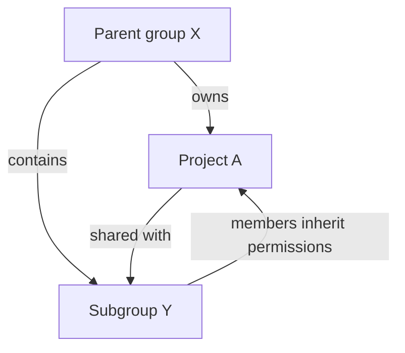
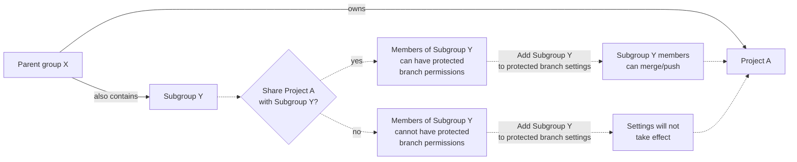



- 티어: Free, Premium, Ultimate
- 제공 서비스: GitLab.com, GitLab Self-Managed, GitLab Dedicated



> [!note]
> 프로젝트의 **보호된 브랜치** 설정이 제거됩니다. **설정** > **리포지토리** > **브랜치 규칙**에서 보호된 브랜치를 구성하세요.

보호된 브랜치는 코드 안정성과 품질을 보장하기 위해 GitLab의 브랜치에 특정 권한을 적용합니다. 보호된 브랜치:

- 머지하고 코드 변경 사항을 푸시할 수 있는 사용자를 제어합니다.
- 중요한 브랜치의 실수로 인한 삭제를 방지합니다.
- 코드 검토 및 승인 프로세스를 적용합니다.
- 코드 소유자 승인 요구사항을 관리합니다.
- 강제 푸시 권한을 규제하여 커밋 기록을 유지합니다.
- UI 및 Protected branches API를 통해 액세스를 제어합니다.

> [!note]
> 리포지토리의 기본 브랜치는 기본적으로 보호됩니다. 기본 브랜치 설정에 대한 자세한 내용은 [기본 브랜치](default.md)를 참조하세요.

브랜치가 여러 규칙과 일치하거나 복잡한 권한 요구사항이 있을 때 보호 규칙의 동작에 대한 정보는 [보호 규칙](protection_rules.md)을 참조하세요.

## 브랜치 보호 {#protect-a-branch}

개별 프로젝트 또는 그룹의 모든 프로젝트에 대한 보호된 브랜치를 구성합니다.

> [!note]
> 그룹 규칙은 프로젝트에서 수정할 수 없지만 프로젝트 유지관리자는 동일한 브랜치 이름에 대한 별도의 규칙을 생성할 수 있습니다. 두 규칙이 동일한 브랜치에 적용되면 GitLab은 일치하는 모든 규칙을 함께 평가하고 대부분의 설정에 대해 가장 허용적인 결과를 적용합니다. 자세한 내용은 [그룹 및 프로젝트 전체의 규칙](protection_rules.md#rules-across-groups-and-projects)을 참조하세요.
<!-- -->
> [!tip]
> 브랜치 이름 또는 패턴을 보호할 때 태그에 대해서도 동일한 이름 또는 패턴을 보호하는 것을 고려하세요. Git을 사용하면 브랜치와 태그가 동일한 이름을 공유할 수 있으므로 둘 다 보호하면 모든 참조에 걸쳐 일관된 액세스 제어가 보장됩니다. 자세한 내용은 [보호된 태그](../../protected_tags.md)를 참조하세요.

### 프로젝트 내 {#in-a-project}

사전 요구 사항:

- Maintainer 또는 Owner 역할이 있어야 합니다.
- 그룹에 **머지 허용** 또는 **푸시와 머지가 허용됨** 권한을 부여할 때 프로젝트는 접근 가능하고 그룹과 공유되어야 합니다. 자세한 내용은 [공유된 프로젝트](../../members/sharing_projects_groups.md)를 참조하세요.

브랜치를 보호하려면:

1. 상단 바에서 **검색 또는 이동**을 선택하고 프로젝트를 찾습니다.
1. 왼쪽 사이드바에서 **설정** > **리포지토리**를 선택합니다.
1. **브랜치 규칙**을 확장합니다.
1. **브랜치 규칙 추가** > **브랜치 이름 또는 패턴**을 선택합니다.
1. 드롭다운 목록에서 보호할 브랜치를 검색하고 선택합니다.
1. **브랜치 규칙 세부정보** 페이지를 보려면 **브랜치 규칙 생성**을 선택합니다.
1. **브랜치 보호** 섹션에서 다음 옵션 중 하나를 선택합니다:
   - **머지 허용**에서 **편집**을 선택합니다.
     1. 이 브랜치에 머지할 수 있는 역할을 선택합니다.
     1. **변경 사항 저장**을 선택합니다.
   - **푸시와 머지가 허용됨**에서 **편집**을 선택합니다.
     1. 이 브랜치에 푸시할 수 있는 역할을 선택합니다.
     1. 선택 사항. **키 배포**를 검색하고 선택합니다.
     1. **변경 사항 저장**을 선택합니다.

> [!note]
> GitLab Premium 및 Ultimate에서 **머지 허용** 및 **푸시와 머지가 허용됨**에 그룹 또는 개별 사용자를 추가할 수도 있습니다.

### 그룹 내 {#in-a-group}



- 티어: Premium, Ultimate
- 제공 서비스: GitLab.com, GitLab Self-Managed, GitLab Dedicated





- GitLab 17.6에서 [일반적으로 사용 가능](https://gitlab.com/gitlab-org/gitlab/-/issues/500250)합니다. 기능 플래그 `group_protected_branches`이 제거되었습니다.



그룹 소유자는 그룹에 대한 보호된 브랜치를 생성할 수 있습니다. 이러한 설정은 그룹의 모든 프로젝트에 적용되며 프로젝트에서 수정할 수 없습니다.

사전 요구 사항:

- 그룹의 Owner 역할이 있어야 합니다.
- 그룹은 최상위 그룹이어야 합니다. 하위 그룹은 지원되지 않습니다.

그룹의 모든 프로젝트에 대한 브랜치를 보호하려면:

1. 상단 표시줄에서 **검색 또는 이동**을 선택하고 그룹을 찾습니다.
1. 왼쪽 사이드바에서 **설정** > **리포지토리**를 선택합니다.
1. **보호된 브랜치**를 확장합니다.
1. **보호된 브랜치 추가**를 선택합니다.
1. **브랜치** 텍스트 상자에 브랜치 이름 또는 [와일드카드](#use-wildcard-rules)(`*`)를 입력합니다. 브랜치 이름과 와일드카드는 대소문자를 구분합니다.
1. **머지 허용** 목록에서 이 브랜치에 머지할 수 있는 역할을 선택합니다.
1. **푸시와 머지가 허용됨** 목록에서 이 브랜치에 푸시할 수 있는 역할을 선택합니다.
1. **강제 푸시 허용** 및 **코드 소유자의 승인이 필요합니다.**에 대한 환경설정을 선택합니다.
1. **보호**를 선택합니다.

## 푸시 및 머지 권한 {#push-and-merge-permissions}

**머지 허용** 및 **푸시와 머지가 허용됨** 설정은 브랜치 보호의 다양한 측면을 제어합니다:

| 설정                       | 목적                                                                                                        | 기본 동작(구성 없음) |
|-------------------------------|----------------------------------------------------------------------------------------------------------------|-----------------------------------|
| **머지 허용**          | 머지 리퀘스트를 통해 변경 사항을 머지하고 UI 및 API를 통해 새로운 보호된 브랜치를 생성할 수 있는 사람을 제어합니다 | **푸시와 머지가 허용됨** 권한이 없는 한 아무도 머지할 수 없습니다. |
| **푸시와 머지가 허용됨** | 기존 보호된 브랜치에 직접 푸시하고 머지 리퀘스트를 통해 머지할 수 있는 사람을 제어합니다                 | 아무도 푸시할 수 없습니다.                  |

> [!note]
> **푸시와 머지가 허용됨**은 푸시 및 머지 기능을 모두 부여합니다. 이 권한이 있는 사용자는 **머지 허용** 권한이 없어도 머지 리퀘스트를 통해 머지할 수 있습니다.

**아무도 없음**을 **머지 허용** 또는 **푸시와 머지가 허용됨**에 대해 선택하면 UI가 다른 역할 선택을 지웁니다. 이 동작은 여러 액세스 수준을 동시에 설정할 수 있는 API와 다릅니다. API 동작에 대한 자세한 내용은 [Protected branches API](../../../../api/protected_branches.md)를 참조하세요.

### 브랜치 유형별 보호 전략 {#protection-strategies-by-branch-types}

다양한 브랜치 유형은 목적과 보안 요구사항에 따라 다양한 보호 수준이 필요합니다.

프로덕션 환경에 배포된 브랜치의 경우:

- **머지 허용**을 **유지관리자**만으로 설정합니다.
- **푸시와 머지가 허용됨**을 **아무도 없음**(비어 있지 않음)으로 설정합니다.
- **코드 소유자의 승인이 필요합니다.**를 활성화합니다.
- 여러 승인을 요구하는 것을 고려하세요.

이 구성으로 모든 변경 사항은 유지관리자 승인이 있는 머지 리퀘스트가 필요합니다.

활성 개발 브랜치의 경우:

- **머지 허용**을 **개발자 + 유지관리자**로 설정합니다.
- **푸시와 머지가 허용됨**을 **아무도 없음**(비어 있지 않음)으로 설정합니다.

이 구성으로 개발자는 승인된 머지 리퀘스트를 머지할 수 있으면서도 모든 변경 사항이 코드 검토를 거치도록 요구합니다.

> [!note]
> **푸시와 머지가 허용됨**이 구성되지 않으면 푸시 액세스를 제한하지 않습니다. 직접 푸시를 방지하려면 **푸시와 머지가 허용됨**을 **아무도 없음**으로 명시적으로 설정해야 합니다.

### 개발자 역할의 권한 조합 {#permission-combinations-for-developer-role}

다음 예에서는 개발자 역할이 있는 사용자가 다양한 보호 구성으로 수행할 수 있는 작업을 보여줍니다:

| 머지 허용         | 푸시와 머지가 허용됨 | 직접 푸시 | 머지 리퀘스트를 통해 머지 |
|--------------------------|---------------------------|-------------|------------------|
| 아무도 없음                   | 개발자 + 유지관리자  |  |       |
| 구성되지 않음           | 개발자 + 유지관리자  |  |       |
| 개발자 + 유지관리자 | 구성되지 않음            |   |       |
| 구성되지 않음           | 구성되지 않음            |   |        |
| 유지관리자              | 구성되지 않음            |   |        |
| 유지관리자              | 유지관리자               |   |        |
| 개발자 + 유지관리자 | 유지관리자               |   |       |

## 기본 브랜치 보호 설정 {#default-branch-protection-settings}

관리자는 **운영자** 영역에서 [기본 브랜치 보호 수준을 설정](default.md#for-all-projects-in-an-instance)할 수 있습니다.

## 와일드카드 규칙 사용 {#use-wildcard-rules}

와일드카드를 사용할 때 여러 규칙이 단일 브랜치에 적용될 수 있습니다. 둘 이상의 규칙이 브랜치에 적용되면 가장 허용적인 규칙이 브랜치의 동작 방식을 제어합니다. 머지 제어가 제대로 작동하려면 **푸시와 머지가 허용됨**을 **머지 허용**보다 더 많은 사용자 집합으로 설정하세요.

사전 요구 사항:

- Maintainer 또는 Owner 역할이 있어야 합니다.

동시에 여러 브랜치를 보호하려면:

1. 상단 바에서 **검색 또는 이동**을 선택하고 프로젝트를 찾습니다.
1. 왼쪽 사이드바에서 **설정** > **리포지토리**를 선택합니다.
1. **브랜치 규칙**을 확장합니다.
1. **브랜치 규칙 추가** > **브랜치 이름 또는 패턴**을 선택합니다.
1. 드롭다운 목록에서 브랜치 이름과 와일드카드(`*`)를 입력합니다. 브랜치 이름과 와일드카드는 대소문자를 구분합니다. 예를 들어:

   | 와일드카드 보호 브랜치 | 일치하는 브랜치                                      |
   |---------------------------|--------------------------------------------------------|
   | `*-stable`                | `production-stable`, `staging-stable`                  |
   | `production/*`            | `production/app-server`, `production/load-balancer`    |
   | `*gitlab*`                | `gitlab`, `gitlab/staging`, `master/gitlab/production` |

1. **와일드카드 생성**를 선택합니다.
1. **브랜치 규칙 생성**을 선택합니다. **브랜치 규칙 세부정보** 페이지로 이동합니다.
1. **브랜치 보호** 섹션에서 다음 옵션 중 하나를 선택합니다:
   - **머지 허용**에서 **편집**을 선택합니다.
     1. 이 브랜치에 머지할 수 있는 역할을 선택합니다.
     1. **변경 사항 저장**을 선택합니다.
   - **푸시와 머지가 허용됨**에서 **편집**을 선택합니다.
     1. 이 브랜치에 머지할 수 있는 역할을 선택합니다.
     1. 원하는 경우 **키 배포**를 검색하여 추가합니다.
     1. **변경 사항 저장**을 선택합니다.

## 보호 옵션 구성 {#configure-protection-options}

브랜치를 보호하기 위해 다양한 보호 옵션을 설정할 수 있습니다.

### 머지 리퀘스트 필요 {#require-merge-requests}

모든 사람이 보호된 브랜치에 직접 체크인하는 것을 허용하지 않고 머지 리퀘스트를 제출하도록 강제할 수 있습니다:

1. 상단 바에서 **검색 또는 이동**을 선택하고 프로젝트를 찾습니다.
1. 왼쪽 사이드바에서 **설정** > **리포지토리**를 선택합니다.
1. **브랜치 규칙**을 확장합니다.
1. 브랜치 옆에서 **상세 보기**를 선택합니다.
1. **머지 허용** 섹션에서 **편집**을 선택합니다
1. **개발자 + 유지관리자**를 선택합니다.
1. **변경 사항 저장**을 선택합니다.
1. **푸시와 머지가 허용됨** 섹션에서 **아무도 없음**을 선택합니다.
1. **변경 사항 저장**을 선택합니다.

### 직접 푸시 허용 {#allow-direct-push}

쓰기 액세스 권한이 있는 모든 사람이 보호된 브랜치에 직접 푸시할 수 있습니다.

1. 상단 바에서 **검색 또는 이동**을 선택하고 프로젝트를 찾습니다.
1. 왼쪽 사이드바에서 **설정** > **리포지토리**를 선택합니다.
1. **브랜치 규칙**을 확장합니다.
1. 브랜치 옆에서 **상세 보기**를 선택합니다.
1. **푸시와 머지가 허용됨** 섹션에서 **개발자 + 유지관리자**를 선택합니다.
1. **변경 사항 저장**을 선택합니다.

### 그룹 권한 포함 {#with-group-permissions}



- 티어: Premium, Ultimate
- 제공 서비스: GitLab.com, GitLab Self-Managed, GitLab Dedicated



그룹 또는 하위 그룹의 멤버를 보호된 브랜치에 대해 **머지 허용** 또는 **푸시와 머지가 허용됨**으로 설정하려면:

1. 상단 바에서 **검색 또는 이동**을 선택하고 프로젝트를 찾습니다.
1. 왼쪽 사이드바에서 **설정** > **리포지토리**를 선택합니다.
1. **브랜치 규칙**을 확장합니다.
1. 브랜치 옆에서 **상세 보기**를 선택합니다.
1. **머지 허용** 또는 **푸시와 머지가 허용됨** 섹션에서 **편집**을 선택합니다.
1. **그룹** 아래에서 검색하여 그룹을 추가합니다. 예를 들어:

   ```plaintext
   # Allow group members to merge into this branch
   Allowed to merge: @group-x

   # Allow group members to push and merge into this branch
   Allowed to push and merge: @group-x/subgroup-y
   ```

1. **변경 사항 저장**을 선택합니다.

> [!note]
> 보호된 브랜치에 그룹을 할당하면 해당 그룹의 직접 멤버만 포함됩니다. 상위 그룹의 멤버는 보호된 브랜치에 대한 권한을 자동으로 부여받지 않습니다.

#### 그룹 상속 요구사항 {#group-inheritance-requirements}



이 예에서:

- 상위 그룹 X(`group-x`)는 프로젝트 A를 소유합니다.
- 상위 그룹 X는 또한 서브그룹인 서브그룹 Y를 포함합니다. (`group-x/subgroup-y`)
- 프로젝트 A는 서브그룹 Y와 공유됩니다.

보호된 브랜치 권한에 적합한 그룹은 다음과 같습니다:

- 프로젝트 A: 프로젝트 A가 서브그룹 Y와 공유되므로 그룹 X와 서브그룹 Y 모두.

#### 그룹과 프로젝트 공유 {#share-projects-with-groups}

그룹 또는 하위 그룹과 프로젝트를 공유하여 해당 멤버가 보호된 브랜치 권한에 적합하도록 할 수 있습니다.



서브그룹 Y 멤버에게 프로젝트 A에 대한 액세스 권한을 부여하려면 서브그룹과 프로젝트를 공유해야 합니다. 보호된 브랜치 설정에 하위 그룹을 직접 추가하는 것은 효과적이지 않으며 하위 그룹 멤버에게 적용할 수 없습니다.

> [!note]
> 그룹이 보호된 브랜치 권한을 갖기 위해서는 프로젝트가 그룹과 직접 공유되어야 합니다. 상위 그룹의 상속된 프로젝트 멤버십은 보호된 브랜치 권한에 충분하지 않습니다.

### 배포 키 액세스 활성화 {#enable-deploy-key-access}

[배포 키](../../deploy_keys/_index.md)로 보호된 브랜치에 푸시할 수 있습니다.

사전 요구 사항:

- 배포 키는 프로젝트에 대해 활성화되어야 합니다. 프로젝트 배포 키는 생성될 때 기본적으로 활성화됩니다. 그러나 공개 배포 키는 프로젝트에 대한 액세스 권한을 부여받아야 합니다.
- 배포 키는 프로젝트 리포지토리에 쓰기 액세스 권한이 있어야 합니다.
- 배포 키의 소유자는 프로젝트에 대해 최소한 읽기 액세스 권한이 있어야 합니다.
- 배포 키의 소유자는 또한 프로젝트의 멤버여야 합니다.

배포 키가 보호된 브랜치에 푸시할 수 있도록 허용하려면:

1. 상단 바에서 **검색 또는 이동**을 선택하고 프로젝트를 찾습니다.
1. 왼쪽 사이드바에서 **설정** > **리포지토리**를 선택합니다.
1. **브랜치 규칙**을 확장합니다.
1. 브랜치 옆에서 **상세 보기**를 선택합니다.
1. **푸시와 머지가 허용됨** 섹션에서 **편집**을 선택합니다.
1. **키 배포**에서 배포 키를 검색하여 추가합니다.
1. **변경 사항 저장**을 선택합니다.

배포 키는 **머지 허용** 드롭다운 목록에서 사용할 수 없습니다.

### 강제 푸시 허용 {#allow-force-push}

보호된 브랜치에 [강제 푸시](../../../../topics/git/git_rebase.md#force-push-to-a-remote-branch)를 허용할 수 있습니다.

브랜치를 보호하고 강제 푸시를 활성화하려면:

1. 상단 바에서 **검색 또는 이동**을 선택하고 프로젝트를 찾습니다.
1. 왼쪽 사이드바에서 **설정** > **리포지토리**를 선택합니다.
1. **브랜치 규칙**을 확장합니다.
1. **브랜치 규칙 추가** > **브랜치 이름 또는 패턴**을 선택합니다.
1. 드롭다운 목록에서 보호하고 강제 푸시를 활성화할 브랜치를 검색하고 선택합니다.
1. **브랜치 규칙 생성**을 선택합니다. **브랜치 규칙 세부정보** 페이지로 이동합니다.
1. **푸시와 머지가 허용됨** 및 **머지 허용** 섹션에서 원하는 설정을 선택합니다.
1. **변경 사항 저장**을 선택합니다.
1. 푸시 액세스 권한이 있는 모든 사용자가 강제 푸시할 수 있도록 하려면 **강제 푸시 허용** 토글을 켜세요.

이미 보호된 브랜치에 강제 푸시를 활성화하려면:

1. 상단 바에서 **검색 또는 이동**을 선택하고 프로젝트를 찾습니다.
1. 왼쪽 사이드바에서 **설정** > **리포지토리**를 선택합니다.
1. **브랜치 규칙**을 확장합니다.
1. 브랜치 옆에서 **상세 보기**를 선택합니다.
1. **강제 푸시 허용** 토글을 켜세요.

### 코드 소유자 승인 필요 {#require-code-owner-approval}



- 티어: Premium, Ultimate
- 제공 서비스: GitLab.com, GitLab Self-Managed, GitLab Dedicated



보호된 브랜치의 경우 [코드 소유자](../../codeowners/_index.md)의 최소 하나의 승인을 요구할 수 있습니다. 브랜치가 여러 규칙으로 보호되는 경우 **코드 소유자의 승인이 필요합니다.**가 활성화되면 코드 소유자 승인이 필요합니다.

새 브랜치를 보호하고 코드 소유자 승인을 활성화하려면:

1. 상단 바에서 **검색 또는 이동**을 선택하고 프로젝트를 찾습니다.
1. 왼쪽 사이드바에서 **설정** > **리포지토리**를 선택합니다.
1. **브랜치 규칙**을 확장합니다.
1. **브랜치 규칙 추가** > **브랜치 이름 또는 패턴**을 선택합니다.
1. 드롭다운 목록에서 보호하고 강제 푸시를 활성화할 브랜치를 검색하고 선택합니다.
1. **브랜치 규칙 생성**을 선택합니다. **브랜치 규칙 세부정보** 페이지로 이동합니다.
1. **푸시와 머지가 허용됨** 및 **머지 허용** 섹션에서 원하는 설정을 선택합니다.
1. **변경 사항 저장**을 선택합니다.
1. **코드 소유자의 승인이 필요합니다.** 토글을 켜세요.

이미 보호된 브랜치에 코드 소유자 승인을 활성화하려면:

1. 상단 바에서 **검색 또는 이동**을 선택하고 프로젝트를 찾습니다.
1. 왼쪽 사이드바에서 **설정** > **리포지토리**를 선택합니다.
1. **브랜치 규칙**을 확장합니다.
1. 브랜치 옆에서 **상세 보기**를 선택합니다.
1. **코드 소유자 승인** 토글을 켜세요.

활성화되면 이러한 브랜치의 모든 머지 리퀘스트는 일치하는 규칙당 코드 소유자의 승인이 필요합니다. 머지되기 전에 승인을 받아야 합니다. 또한 규칙이 일치하면 보호된 브랜치에 직접 푸시가 거부됩니다.

`CODEOWNERS` 파일에 지정되지 않은 모든 사용자는 특별히 허용되지 않는 한 지정된 파일 또는 경로에 대한 변경 사항을 푸시할 수 없습니다. 개발자가 보호된 브랜치에 직접 푸시하는 것을 제한할 필요는 없습니다. 대신 코드 소유자의 검토가 필요한 특정 파일로 푸시를 제한할 수 있습니다.

보호된 브랜치에 푸시할 수 있는 사용자 및 그룹은 기능 브랜치를 머지하기 위해 머지 리퀘스트가 필요하지 않습니다. 따라서 머지 리퀘스트 승인 규칙, 코드 소유자를 포함하여 건너뛸 수 있습니다.

### 브랜치 보호를 해제할 수 있는 사람 제어 {#control-who-can-unprotect-branches}



- 티어: Premium, Ultimate
- 제공 서비스: GitLab.com, GitLab Self-Managed, GitLab Dedicated



브랜치를 보호할 때 나중에 보호를 해제할 수 있는 사람을 제어할 수도 있습니다. 기본적으로 유지관리자 또는 소유자 역할이 있는 사용자는 보호된 브랜치의 보호를 해제할 수 있습니다.

규제 또는 준수 요구사항이 있는 조직의 경우 이러한 권한을 특정 사용자, 그룹 또는 액세스 수준으로 제한할 수 있습니다.

> [!note]
> 브랜치의 보호 설정을 영구적으로 잠그는 것을 방지하려면 최소한 하나의 사용자 또는 그룹이 항상 브랜치의 보호 해제 권한을 유지하는지 확인하세요.
>
> 사용자는 브랜치 자체의 보호를 해제할 수 있는 경우가 아니면 보호된 브랜치 설정을 생성, 수정 또는 삭제할 수 없습니다. 이 안전 메커니즘은 구성 오류를 방지하기 위해 마련되었습니다.

API를 통해서만 이러한 권한을 구성할 수 있습니다. 다음의 경우 이 기능을 사용합니다:

- 규제 준수: 승인된 담당자만 브랜치 보호를 수정할 수 있는지 확인합니다.
- 대규모 조직: 여러 리포지토리에 걸쳐 보호 제거가 실수로 발생하는 것을 방지합니다.
- 자동화된 거버넌스: 개발 팀이 재정의할 수 없는 관리자만 보호를 생성하는 스크립트를 활성화합니다.

보호 해제 권한에 대한 유효한 액세스 수준 및 제약에 대한 정보는 [유효한 액세스 수준](../../../../api/protected_branches.md#valid-access-levels)을 참조하세요.

#### 보호 해제 권한 {#unprotect-permissions}

다음 표는 구성에 따라 브랜치의 보호를 해제할 수 있는 사람을 보여줍니다:

| 구성                     | 보호 해제할 수 있는 사람 |
|-----------------------------------|-------------------|
| 기본 동작                  | 유지관리자 또는 소유자 역할이 있는 사용자 |
| 특정 사용자 구성         | 지정된 사용자만 |
| 특정 그룹 구성        | 지정된 그룹의 멤버만 |
| 여러 액세스 수준 구성 | 구성된 액세스 수준에서 모든 사용자, 그룹 또는 역할 |

## 보호된 브랜치의 CI/CD {#cicd-on-protected-branches}

보호된 브랜치에 머지하거나 푸시할 권한은 사용자가 CI/CD 파이프라인을 실행하고 작업에 대한 작업을 실행할 수 있는지 여부를 정의합니다.

머지 리퀘스트 파이프라인은 소스 브랜치 또는 소스 브랜치를 기반으로 한 머지 리퀘스트 참조에서 실행됩니다. 사용자가 소스 브랜치에 머지하거나 푸시할 권한이 없으면 파이프라인이 생성되지 않습니다.

머지 리퀘스트가 보호된 브랜치 간일 경우 사용자가 소스 및 대상 브랜치 모두를 업데이트할 권한이 있으면 보호된 변수와 러너를 파이프라인에 사용할 수 있습니다. 자세한 내용은 [보호된 변수 및 러너에 대한 액세스 제어](../../../../ci/pipelines/merge_request_pipelines.md#control-access-to-protected-variables-and-runners)를 참조하세요.

## 보호된 브랜치 생성 {#create-protected-branches}

사전 요구 사항:

- Developer, Maintainer 또는 Owner 역할이 있어야 합니다.
- 보호된 브랜치를 생성하려면 브랜치 보호가 [모든 사람이 보호된 브랜치에 대한 머지 리퀘스트를 제출하도록 요구](#require-merge-requests)하도록 구성되어야 합니다.

보호 기능과 함께 새 브랜치를 생성하려면:

1. 상단 바에서 **검색 또는 이동**을 선택하고 프로젝트를 찾습니다.
1. 왼쪽 사이드바에서 **코드** > **브랜치**를 선택합니다.
1. **새 브랜치**를 선택합니다.
1. 브랜치 이름을 입력하고 새 브랜치의 기반이 될 기존 브랜치, 태그 또는 커밋을 선택합니다. 모든 사람이 보호된 브랜치에 대한 머지 리퀘스트를 제출하도록 요구하는 경우 기존 보호된 브랜치 및 이미 보호된 브랜치에 있는 커밋만 허용됩니다.

Branches API를 사용하여 보호 기능이 있는 브랜치를 생성할 수도 있습니다.

브랜치 보호가 [모든 사람이 보호된 브랜치에 직접 푸시하도록 허용](#allow-direct-push)하도록 구성된 경우 명령줄 또는 Git 클라이언트 애플리케이션에서도 보호 기능이 있는 브랜치를 생성할 수 있습니다.

## 보호된 브랜치 삭제 {#delete-protected-branches}

유지관리자 또는 소유자 역할이 있는 사용자는 GitLab 웹 인터페이스를 사용하여 보호된 브랜치를 수동으로 삭제할 수 있습니다:

1. 상단 바에서 **검색 또는 이동**을 선택하고 프로젝트를 찾습니다.
1. 왼쪽 사이드바에서 **코드** > **브랜치**를 선택합니다.
1. 삭제할 브랜치 옆에서 **추가 작업**()을 선택합니다.
1. **보호된 브랜치 지우기**를 선택합니다.
1. 확인 대화상자에서 브랜치 이름을 입력하고 **예, 보호된 브랜치를 삭제합니다.**를 선택합니다. 브랜치 이름은 대소문자를 구분합니다.

GitLab UI 또는 API를 사용하여 보호된 브랜치를 삭제할 수만 있습니다. 로컬 Git 명령 또는 타사 Git 클라이언트로 보호된 브랜치를 삭제할 수 없습니다.

## 정책 적용 {#policy-enforcement}

보안 및 준수를 위해 [머지 리퀘스트 승인 정책](../../../application_security/policies/merge_request_approval_policies.md#approval_settings)을 구현할 수 있으며 이는 인스턴스, 그룹 또는 프로젝트에서 정의된 설정에 영향을 미칩니다. 정책은 사용자가 브랜치의 보호를 해제하거나 삭제하거나 푸시하거나 강제 푸시할 수 있는 능력에 영향을 미칠 수 있습니다.

## 관련 항목 {#related-topics}

- [보호 규칙 및 권한](protection_rules.md)
- [Protected branches API](../../../../api/protected_branches.md)
- [브랜치](_index.md)
- [브랜치 API](../../../../api/branches.md)
- [커밋 API](../../../../api/commits.md)
- [코드 소유자](../../codeowners/_index.md#code-owners-and-protected-branches)

## 문제 해결 {#troubleshooting}

### 브랜치 이름은 대소문자를 구분함 {#branch-names-are-case-sensitive}

`git`의 브랜치 이름은 대소문자를 구분합니다. 보호된 브랜치를 구성할 때 또는 [대상 브랜치 워크플로우](_index.md#configure-workflows-for-target-branches)를 구성할 때 `dev`은 `DEV` 또는 `Dev`와 같지 않습니다.
