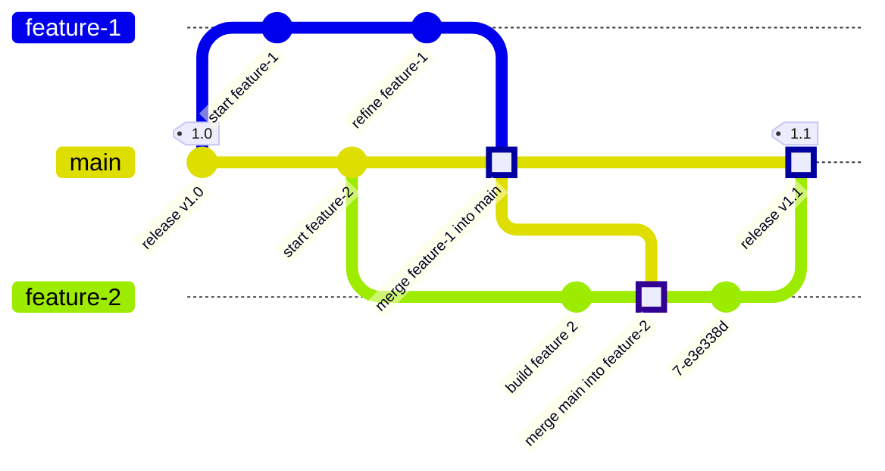
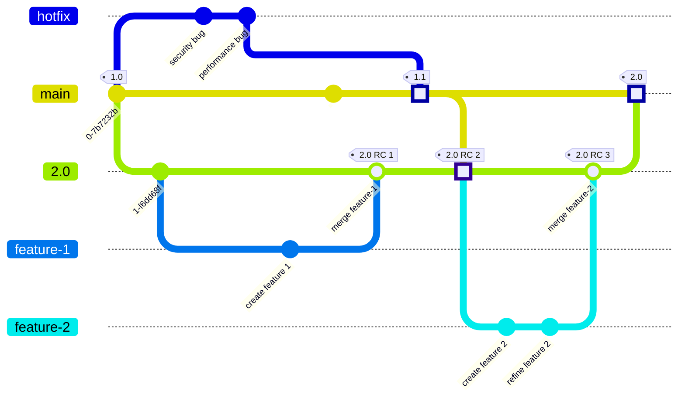
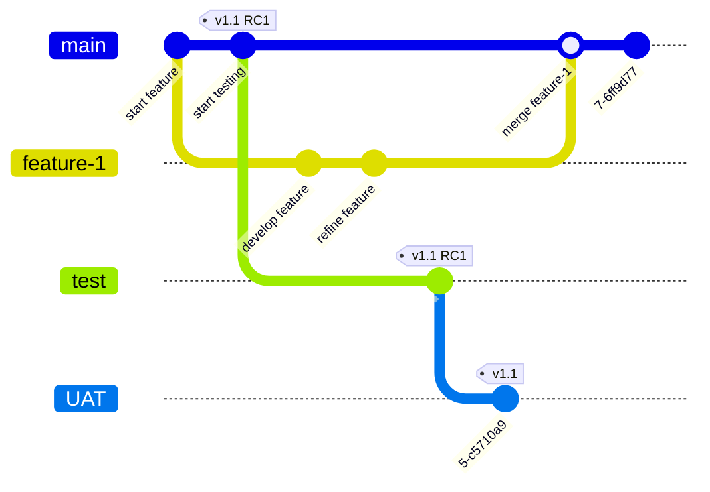

Git 브랜치를 구성하고 병합하는 방식을 브랜칭 전략이라고 합니다. 많은 팀에 가장 간단한 접근 방식이 합리적이고 효과적입니다:

1. 기능 브랜치에서 변경 사항을 만듭니다.
1. 기능 브랜치를 `main`로 직접 병합합니다.

하지만 팀에 테스트 및 규정 준수 요구 사항과 같은 복잡한 필요가 있다면 다른 브랜칭 전략을 고려할 수 있습니다.

다음 섹션에서는 사용 가능한 보다 일반적인 전략들을 설명합니다. 모든 팀이 Git(또는 버전 관리) 전문가를 보유하고 있는 것은 아닙니다. 팀이 Git 기술 수준의 한계에서 작업하고 있다면 이 정보가 도움이 될 수 있습니다.

GitLab을 여러 개의 서로 다른 도구를 대체하는 데 사용할 때 Git 브랜칭 전략에 대해 내리는 결정이 중요합니다. 신중한 계획을 통해 다음 사이에 명확한 연결을 확립할 수 있습니다:

- 받는 초기 버그 보고서
- 팀이 이러한 버그를 수정하기 위해 만드는 커밋
- 이러한 수정 사항을 다른 버전 또는 고객에게 백포팅하는 프로세스
- 사용자가 수정 사항을 이용할 수 있도록 하는 배포

신중한 선택은 GitLab의 단일 데이터 저장소를 최대한 활용하는 데 도움이 됩니다.

## 더 복잡한 Git 브랜칭 전략이 필요한가? {#do-i-need-a-more-complex-git-branching-strategy}

다음과 같은 경우 현재 Git 브랜칭 전략을 벗어났을 수 있습니다:

- 지속적 배포를 사용합니다.
- 자동화된 테스트가 대량으로 있습니다.
- 다른 고객에게 영향을 주지 않고 한 고객을 위한 중요한 버그를 수정해야 합니다.
- 제품의 여러 역사적 버전을 유지합니다.
- 제품이 여러 운영 체제 또는 플랫폼을 지원하기 때문에 단일 프로덕션 브랜치가 없습니다.
- 각 버전마다 다른 배포 또는 인증 요구 사항이 있습니다.

제품이 필요로 하는 것보다 더 복잡한 전략을 구현하지 마세요.

### 프로젝트를 여러 리포지토리로 분할하는 시기 {#when-to-split-a-project-into-multiple-repositories}

복잡한 브랜칭 구조를 가진 하나의 Git 리포지토리를 유지해야 하거나 프로젝트를 여러 리포지토리로 분할해야 할까요? 단 하나의 정답은 없습니다. 인력과 전문 지식으로 지원할 수 있는 것에 따라 다릅니다.

GitLab은 리포지토리가 단일 제품용이라고 가정하는 자동화를 제공하지만, 해당 제품은 여러 버전을 포함할 수 있습니다. 여러 리포지토리를 가져야 하는지 아니면 하나의 복잡한 리포지토리를 가져야 하는지 결정하려면 다음 질문을 하세요:

- 같은 제품인가요?
- 모든 요소가 같은 빌드 프로세스를 사용하나요?
- 기본 코드가 유사한가요, 아니면 같은가요?

무엇을 선택하든(복잡한 단일 리포지토리든 더 작은 리포지토리 세트든) 유지 관리에 엔지니어링 시간을 소비할 것으로 예상해야 합니다. 수행할 준비가 되어 있는 엔지니어링 작업의 유형을 파악하세요:

- 단일 리포지토리에서 여러 제품의 코드를 유지한다면 나중에 GitLab의 모든 기능을 사용하기 위해 사용자 지정 작업을 계획하세요.
- 여러 리포지토리 간에 작업을 병합하는 것이 같은 리포지토리의 브랜치 간에 병합하는 것보다 더 복잡합니다. 사용자 지정 릴리스 프로세스를 구축하고 리포지토리 간에 코드 흐름을 관리하기 위한 엔지니어링 시간을 계획하세요.

> [!note]
> 조직에서 대규모 모노레포 또는 메가레포를 사용한다면 GitLab의 [Professional Services](https://about.gitlab.com/services/) 팀이 필요에 맞는 사용자 지정 브랜칭 솔루션을 구축하도록 도와줄 수 있습니다.

## 주요 브랜칭 전략 유형 {#major-types-of-branching-strategies}

브랜칭 및 코드 관리 전략은 제품의 필요에 따라 달라집니다. 기존 전략으로는 모든 것을 포괄할 수 없지만 주요 범주들은:

- [웹 서비스](#web-services)
- [오래 유지되는 릴리스 브랜치](#long-lived-release-branches)
- [환경별 브랜치](#branch-per-environment)

### 웹 서비스 {#web-services}

이 전략은 표준 Git 실천을 따릅니다. `main` 브랜치는 프로덕션 브랜치이며, 단일 웹 서비스에 매우 적합합니다: 하나의 정확한 프로덕션 버전이 있고 이전 버전을 지원하지 않습니다.

이 구성의 경우 [`git-flow`](https://nvie.com/posts/a-successful-git-branching-model/)이 당신에게 잘 작동합니다. 표준화되어 있으므로 아무것도 유지할 필요가 없습니다.

이 예제에서 `feature-1`은 `main`에서 직접 분기됩니다. 완료되면 `feature-1`이 `main`로 직접 병합됩니다. 이 병합 커밋은 사각형으로 강조 표시됩니다. `feature-2`과 같은 오래 유지되는 브랜치는 개발의 일부로 `main`의 최신 업데이트를 정기적으로 병합할 수 있습니다. 완료되면 `feature-2`이 `main`로 병합되고 릴리스 `1.1`가 생성됩니다:

### 오래 유지되는 릴리스 브랜치 {#long-lived-release-branches}

이 브랜칭 전략은 제품에 오랜 기간 동안 `main`에서 분리된 상태로 유지되어야 하는 브랜치가 있는 경우에 적절합니다. 몇 가지 예제는 다음과 같습니다:

- 동일한 소프트웨어 패키지의 여러 프로덕션 버전 예를 들어 현재 버전과 레거시 버전 현재 버전은 기능 업데이트와 핫픽스를 받고 이전 버전은 핫픽스 및 보안 릴리스만 받습니다.
- 현재 프로덕션 버전과 오래 유지되는 베타 버전 주요 소프트웨어 종속성(예: 소프트웨어 개발 키트 또는 SDK)이 주요 변경을 도입하는 경우 이 접근 방식이 필요할 수 있습니다. 현재 프로덕션 버전은 기능 업데이트와 핫픽스를 받습니다. 베타 버전은 이러한 기능 업데이트와 핫픽스를 받으면서 팀도 향후 SDK 변경에 대한 지원을 구축합니다.

오래 유지되는 브랜치를 잠금으로써 설정하려면 핫픽스 프로세스를 정의하고 적용하는 것이 중요합니다. 정의되지 않고 적용되지 않으면 모든 변경이 핫픽스가 됩니다.

이 예제에서 `2.0` 브랜치는 `main`의 커밋에서 `1.0` 릴리스용으로 생성됩니다. 기능들은 `2.0` 브랜치에서 분기되고 `2.0`로 다시 병합됩니다. 동시에 핫픽스 브랜치는 `main`의 가장 최근 릴리스인 `1.0`에서 기반으로 하며 릴리스 `1.1`에서 `main`으로 다시 병합됩니다. `2.0` 브랜치는 릴리스 `1.1`의 변경 사항을 가져온 후 `2.0`의 개발의 일부로 이를 통합합니다. 다른 기능 추가 후(`feature-2`) `2.0` 브랜치는 프로덕션 준비가 완료됩니다. `main`로 병합되고 릴리스 `2.0`이 생성됩니다:

#### SVN 브랜칭 전략에서 마이그레이션 {#migrate-from-svn-branching-strategies}

SVN에서 Git으로 마이그레이션하는 레거시 프로젝트는 브랜칭 접근 방식을 검토해야 합니다. Git의 일부 SVN 중심 브랜칭 접근 방식은 GitLab에서 최대한 활용하지 못하게 할 수 있습니다. 재검토할 일부 워크플로:

- `main`에서 `1.0` 같은 오래 유지되는 브랜치를 생성한 후 `1.0` 브랜치를 잠가 사전 승인된 핫픽스가 아닌 변경을 차단합니다.
  - Git은 SVN보다 머지 충돌을 더 잘 처리합니다.
  - 계약상 의무가 있는 경우가 아니면 오래 유지되는 브랜치를 만드는 것을 피하세요. Git이 충돌을 잘 처리하지만 오래 유지되는 브랜치는 여러 브랜치에 수정 사항을 병합하는 데 시간을 소비해야 합니다.
- 제품이 기능 플래그를 지원하지 않기 때문에 브랜치를 사용합니다.

### 환경별 브랜치 {#branch-per-environment}

이 브랜칭 전략은 다른 팀에서 만든 여러 상호 의존적인 서비스가 있는 조직에서 흔합니다. 폭포수 또는 V 모델 개발 프로세스에서 자주 사용됩니다.

이 예제에서 `v1.1 RC1`로 표시된 커밋은 버전 `1.1`의 릴리스 후보로 식별됩니다. 기능들은 `main`에서 계속 분기되고 다시 병합되는 동안 릴리스 후보 커밋은 `test` 및 `UAT` 환경에서 테스트됩니다. 이 프로세스는 릴리스로 간주되는 각 커밋에 대해 반복됩니다:

## 관련 항목 {#related-topics}

- [보호된 브랜치](../protected.md)
- [병합 요청 승인](../../../merge_requests/approvals/_index.md)
- [머지된 결과 테스트](../../../../../ci/pipelines/merged_results_pipelines.md)
