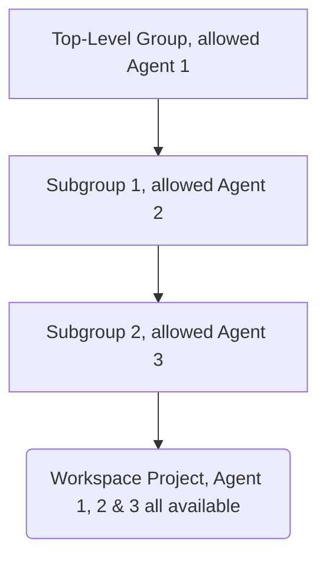



- 티어: Premium, Ultimate
- 제공 서비스: GitLab.com, GitLab Self-Managed, GitLab Dedicated



[워크스페이스 인프라를 설정](configuration.md#set-up-workspace-infrastructure)할 때 워크스페이스를 지원하기 위해 Kubernetes용 GitLab 에이전트를 구성해야 합니다. 이 가이드에서는 Kubernetes 클러스터에 GitLab 에이전트가 이미 설치되어 있다고 가정합니다.

사전 요구 사항:

- [Kubernetes용 GitLab 에이전트 설정 튜토리얼](set_up_gitlab_agent_and_proxies.md)의 설정 단계를 완료해야 합니다.
- 에이전트 구성에는 `remote_development` 모듈이 활성화되어 있어야 하며, 이 모듈의 필수 필드를 올바르게 설정해야 합니다.

  > [!note]
  > `remote_development` 모듈을 활성 워크스페이스가 있는 에이전트에서 비활성화하면 해당 워크스페이스를 사용할 수 없게 됩니다. 자세한 정보는 [워크스페이스 설정](settings.md#enabled)을 참조하세요.
- 워크스페이스를 만들기 위해 그룹에 에이전트를 허용해야 합니다. 워크스페이스를 만들 때 사용자는 워크스페이스 프로젝트의 모든 상위 그룹과 연결된 허용된 에이전트를 선택할 수 있습니다.
- 워크스페이스 작성자는 에이전트의 프로젝트에 대한 개발자 역할을 가져야 합니다.

## 워크스페이스를 만들기 위한 그룹의 에이전트 권한 부여 {#agent-authorization-in-a-group-for-creating-workspaces}



- 새로운 권한 부여 전략은 GitLab 17.2에서 [도입](https://gitlab.com/groups/gitlab-org/-/epics/14025)되었습니다.



새로운 권한 부여 전략은 [레거시 권한 부여 전략](#legacy-agent-authorization-strategy)을 대체합니다. 그룹 소유자와 관리자는 자신의 그룹에 워크스페이스를 호스트하는 클러스터 에이전트를 제어할 수 있습니다.

예를 들어 워크스페이스 프로젝트의 경로가 `top-level-group/subgroup-1/subgroup-2/workspace-project`인 경우 `top-level-group`, `subgroup-1` 또는 `subgroup-2` 그룹에 구성된 모든 에이전트를 사용할 수 있습니다.

특정 그룹(예: `subgroup-1`)에 대한 클러스터 에이전트를 허용하면 해당 그룹 아래의 모든 프로젝트에서 워크스페이스를 만들 수 있습니다. 클러스터 에이전트가 워크스페이스를 호스트할 수 있는 위치를 결정하므로 허용된 그룹의 범위를 신중하게 고려하세요.

## 그룹에서 워크스페이스에 대한 클러스터 에이전트 허용 {#allow-a-cluster-agent-for-workspaces-in-a-group}

사전 요구 사항:

- [워크스페이스 인프라를 설정](configuration.md#set-up-workspace-infrastructure)해야 합니다.
- 인스턴스에 대한 관리자 액세스 또는 그룹에 대한 소유자 역할이 있어야 합니다.

그룹에서 워크스페이스에 대한 클러스터 에이전트를 허용하려면:

1. 상단 표시줄에서 **검색 또는 이동**을 선택하고 그룹을 찾습니다.
1. 왼쪽 사이드바에서 **설정** > **작업공간**을 선택합니다.
1. **그룹 에이전트** 섹션에서 **모든 에이전트** 탭을 선택합니다.
1. 사용 가능한 에이전트 목록에서 상태가 **차단됨**인 에이전트를 찾아 **허용**을 선택합니다.
1. 확인 대화상자에서 **에이전트 허용**을 선택합니다.

GitLab은 선택한 에이전트의 상태를 **허용됨**으로 업데이트하고 **허용된 에이전트** 탭에 에이전트를 표시합니다.

## 그룹에서 워크스페이스에 대한 허용된 클러스터 에이전트 제거 {#remove-an-allowed-cluster-agent-for-workspaces-in-a-group}

사전 요구 사항:

- [워크스페이스 인프라를 설정](configuration.md#set-up-workspace-infrastructure)해야 합니다.
- 인스턴스에 대한 관리자 액세스 또는 그룹에 대한 소유자 역할이 있어야 합니다.

그룹에서 허용된 클러스터 에이전트를 제거하려면:

1. 상단 표시줄에서 **검색 또는 이동**을 선택하고 그룹을 찾습니다.
1. 왼쪽 사이드바에서 **설정** > **작업공간**을 선택합니다.
1. **그룹 에이전트** 섹션에서 **허용된 에이전트** 탭을 선택합니다.
1. 허용된 에이전트 목록에서 제거할 에이전트를 찾아 **차단**을 선택합니다.
1. 확인 대화상자에서 **에이전트 차단**을 선택합니다.

GitLab은 선택한 에이전트의 상태를 **차단됨**으로 업데이트하고 **허용된 에이전트** 탭에서 에이전트를 제거합니다.

> [!note]
> 그룹에서 허용된 클러스터 에이전트를 제거해도 에이전트를 사용하는 실행 중인 워크스페이스는 즉시 중지되지 않습니다. 실행 중인 워크스페이스는 자동으로 종료되거나 수동으로 중지될 때 중지됩니다.

## 인스턴스에서 워크스페이스에 대한 클러스터 에이전트 허용 {#allow-a-cluster-agent-for-workspaces-on-the-instance}



- GitLab 18.2에서 [도입](https://gitlab.com/gitlab-org/gitlab/-/issues/548951)되었습니다.



사전 요구 사항:

- [워크스페이스 인프라를 설정](configuration.md#set-up-workspace-infrastructure)해야 합니다.
- [원격 개발이 활성화](settings.md#enabled)된 에이전트가 있어야 합니다.
- 인스턴스에 대한 관리자 액세스 권한이 있어야 합니다.

인스턴스에서 워크스페이스에 대한 클러스터 에이전트를 허용하려면:

1. 오른쪽 위 모서리에서 **Admin**을 선택합니다.
1. 왼쪽 사이드바에서 **설정** > **일반**을 선택합니다.
1. **워크스페이스에 가용한 에이전트**를 확장합니다.
1. 워크스페이스가 활성화된 에이전트 목록에서 허용할 에이전트를 찾아 가용성 토글을 선택합니다.

## 인스턴스에서 워크스페이스에 대한 허용된 클러스터 에이전트 제거 {#remove-an-allowed-cluster-agent-for-workspaces-on-the-instance}



- GitLab 18.2에서 [도입](https://gitlab.com/gitlab-org/gitlab/-/issues/548951)되었습니다.



사전 요구 사항:

- 인스턴스에 대한 관리자 액세스 권한이 있어야 합니다.

인스턴스에서 허용된 클러스터 에이전트를 제거하려면:

1. 오른쪽 위 모서리에서 **Admin**을 선택합니다.
1. 왼쪽 사이드바에서 **설정** > **일반**을 선택합니다.
1. **워크스페이스에 가용한 에이전트**를 확장합니다.
1. 허용된 에이전트 목록에서 제거할 에이전트를 찾아 가용성 토글을 지웁니다.

> [!note]
> 인스턴스에서 허용된 클러스터 에이전트를 제거해도 에이전트를 사용하는 실행 중인 워크스페이스는 즉시 중지되지 않습니다. 실행 중인 워크스페이스는 자동으로 종료되거나 수동으로 중지될 때 중지됩니다.

## 레거시 에이전트 권한 부여 전략 {#legacy-agent-authorization-strategy}

GitLab 17.1 이전에는 그룹의 에이전트 가용성이 워크스페이스를 만들기 위한 전제 조건이 아니었습니다. 워크스페이스 프로젝트의 최상위 그룹의 모든 에이전트를 사용하여 워크스페이스를 만들 수 있습니다. 단, 다음 두 조건이 모두 충족되어야 합니다:

- 원격 개발 모듈이 활성화되어 있습니다.
- 최상위 그룹에 대한 개발자, 유지보수자 또는 소유자 역할을 가지고 있습니다.

예를 들어 워크스페이스 프로젝트의 경로가 `top-level-group/subgroup-1/subgroup-2/workspace-project`인 경우 `top-level-group` 및 해당 하위 그룹의 구성된 에이전트를 사용할 수 있습니다.

## 원격 개발으로 사용자 액세스 구성 {#configuring-user-access-with-remote-development}

`user_access` 모듈을 구성하여 GitLab 자격 증명으로 연결된 Kubernetes 클러스터에 액세스할 수 있습니다. 이 모듈은 `remote_development` 모듈과 독립적으로 구성되고 실행됩니다.

같은 에이전트에서 `user_access` 및 `remote_development`를 모두 구성할 때 주의하세요. `remote_development` 클러스터는 사용자 자격 증명(예: 개인 액세스 토큰)을 Kubernetes Secrets로 관리합니다. `user_access`의 잘못된 구성으로 인해 이 개인 데이터가 Kubernetes API를 통해 액세스될 수 있습니다.

`user_access` 구성에 대한 자세한 내용은 [Kubernetes 액세스 구성](../clusters/agent/user_access.md#configure-kubernetes-access)을 참조하세요.

## 관련 항목 {#related-topics}

- [튜토리얼: Kubernetes용 GitLab 설정](set_up_gitlab_agent_and_proxies.md)
- [워크스페이스 설정](settings.md)
- [워크스페이스 구성](configuration.md)
- [워크스페이스 문제 해결](workspaces_troubleshooting.md)
