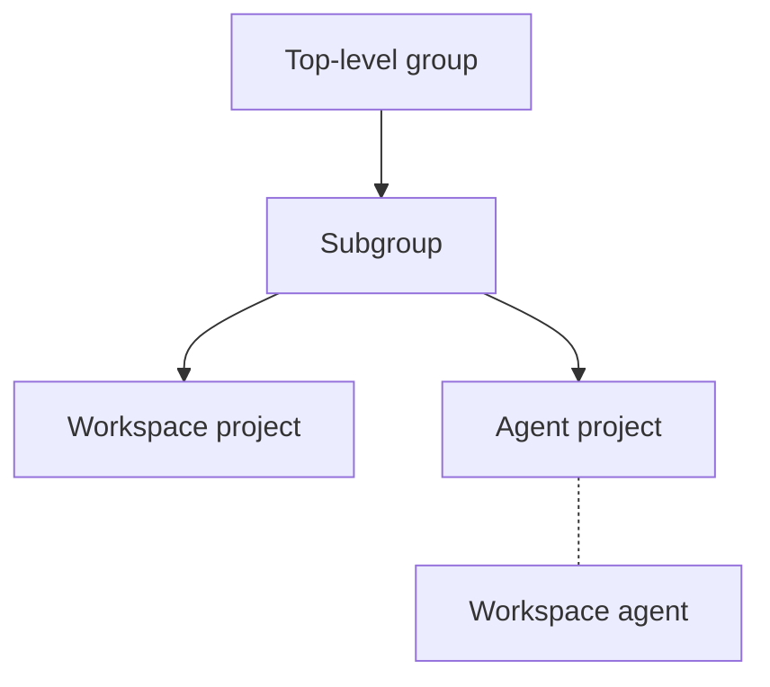

<!-- vale gitlab_base.FutureTense = NO -->

이 튜토리얼에서는 다음을 수행하는 방법을 보여줍니다:

- [Kubernetes용 GitLab 에이전트](../clusters/agent/_index.md)를 설정하여 사용자가 프로젝트에서 워크스페이스를 생성하고 관리할 수 있습니다.
- GitLab 워크스페이스 프록시를 설정하여 클러스터의 [워크스페이스](_index.md)를 인증하고 권한을 부여합니다.

> [!note]
> 이 튜토리얼을 완료하기 전에 설정 단계를 완료해야 Kubernetes용 GitLab 에이전트를 워크스페이스를 지원하도록 구성할 수 있습니다. 튜토리얼을 완료한 후 [Kubernetes용 GitLab 에이전트 구성](gitlab_agent_configuration.md)을 사용하여 에이전트를 구성합니다.

## 시작하기 전에 {#before-you-begin}

이 튜토리얼을 시작하기 전에 다음을 준비해야 합니다:

- GitLab 인스턴스에 대한 관리자 액세스 또는 그룹의 소유자 역할
- 실행 중인 Kubernetes 클러스터
- `helm` 3.11.0 이상 및 로컬 머신의 `kubectl`
- DNS 공급자에서 와일드카드 도메인을 구성할 수 있는 액세스 권한 예를 들어 `*.workspaces.example.dev`은 워크스페이스 액세스에 필요합니다.

이 튜토리얼에서는 다음 계층 구조를 사용합니다:



## Ingress 컨트롤러 설치 {#install-an-ingress-controller}

Kubernetes 클러스터에서 선택한 [Ingress 컨트롤러](https://kubernetes.io/docs/concepts/services-networking/ingress-controllers/)를 설치하여 워크스페이스로 외부 트래픽을 라우팅합니다. Ingress 컨트롤러는 WebSocket을 지원해야 합니다. 다음 예는 [Ingress NGINX 컨트롤러](https://github.com/kubernetes/ingress-nginx)를 사용합니다.

1. Kubernetes 클러스터에서 Ingress 컨트롤러를 설치합니다.

   ```shell
   helm repo add ingress-nginx https://kubernetes.github.io/ingress-nginx
   helm repo update
   helm install ingress-nginx ingress-nginx/ingress-nginx \
     --namespace gitlab-ingress-controller \
     --create-namespace
   ```

1. Load Balancer의 외부 IP 주소를 가져옵니다. [DNS 레코드](#update-your-dns-records)를 업데이트할 때 필요합니다.

   ```shell
   kubectl get svc -n gitlab-ingress-controller ingress-nginx-controller
   ```

## Kubernetes용 GitLab 에이전트 설치 {#install-the-gitlab-agent-for-kubernetes}

Kubernetes 클러스터에서 [Kubernetes용 GitLab 에이전트](../clusters/agent/_index.md#kubernetes-integration-glossary)를 설치하여 클러스터를 GitLab에 연결합니다:

1. [Kubernetes 에이전트 설치](../clusters/agent/install/_index.md)의 설치 옵션 중 하나를 완료합니다.
1. 구성한 `agentName`을(를) 기록합니다. 워크스페이스에 대한 에이전트를 구성할 때 필요합니다.

## GitLab Relay(KAS) 설치 {#install-gitlab-relay-kas}

GitLab Relay(KAS)는 클러스터의 에이전트와 통신하는 구성 요소입니다.

- GitLab.com에서는 GitLab Relay(KAS)를 기본적으로 `grpcs://kas.gitlab.com`에서 사용할 수 있습니다.
- GitLab Self-Managed에서는 관리자가 [GitLab Relay(KAS)를 설정](../../administration/clusters/kas.md)해야 합니다. `grpcs://gitlab.example.com`에서 사용할 수 있으며, HTTPS가 없거나 상대 URL 루트가 있는 인스턴스에서는 `wss://gitlab.example.com/-/kubernetes-agent/`에서 사용할 수 있습니다.

## Kubernetes용 GitLab 에이전트 구성 {#configure-the-gitlab-agent-for-kubernetes}

에이전트 프로젝트에서 `remote_development` 모듈을 구성하려면:

1. 상단 바에서 **검색 또는 이동**을 선택하고 프로젝트를 찾습니다.
1. 프로젝트에서 `.gitlab/agents/<agentName>/config.yaml` 파일을 생성합니다. `agentName`은(는) 워크스페이스 인프라를 설정할 때 구성한 에이전트의 이름입니다.
1. `config.yaml`에서 워크스페이스 설정에 대해 다음 구성을 사용합니다:

   ```yaml
   remote_development:
     enabled: true
     dns_zone: "<workspaces.example.dev>" # DNS zone of the URL where workspaces are available
   ```

구성 옵션의 전체 목록은 워크스페이스 [구성 참조](settings.md#configuration-reference)를 참조하세요.

> [!note]
> Kubernetes용 GitLab 에이전트는 한 프로젝트에서 구성되지만 다른 프로젝트 워크스페이스에서 사용할 수 있습니다. 각 프로젝트마다 별도의 에이전트가 필요하지 않습니다.
>
> 구성된 에이전트는 [그룹에서 에이전트를 허용](#allow-the-gitlab-agent-for-kubernetes-in-your-group)할 때까지 표시되지 않습니다.

## 그룹에서 Kubernetes용 GitLab 에이전트 허용 {#allow-the-gitlab-agent-for-kubernetes-in-your-group}

그룹에서 에이전트를 허용하면 해당 그룹, 하위 그룹 및 이러한 그룹의 모든 프로젝트가 해당 에이전트를 사용할 수 있습니다.

> [!note]
> 하나의 에이전트만 필요합니다. 동일한 에이전트를 사용하여 그룹의 모든 프로젝트에서 워크스페이스를 생성할 수 있습니다.

그룹에서 Kubernetes용 GitLab 에이전트를 허용하고 해당 그룹의 모든 프로젝트에서 사용할 수 있도록 하려면:

1. 상단 표시줄에서 **검색 또는 이동**을 선택하고 그룹을 찾습니다.
1. 왼쪽 사이드바에서 **설정** > **작업공간**을 선택합니다.
1. **그룹 에이전트** 섹션에서 **모든 에이전트** 탭을 선택합니다.
1. Kubernetes용 GitLab 에이전트의 경우 **허용**을 선택합니다.
1. 확인 대화상자에서 **에이전트 허용**을 선택합니다.

## 워크스페이스 권한 부여 {#grant-workspace-permissions}

워크스페이스 및 에이전트 프로젝트에 대한 개발자, 유지 관리자 또는 소유자 역할을 가진 사용자에게 워크스페이스를 생성하고 관리할 수 있는 필요한 권한을 부여합니다. 다음과 같이 수행할 수 있습니다.

- [프로젝트에 사용자 추가](../project/members/_index.md#add-users-to-a-project)
- [그룹에 사용자 추가](../group/_index.md#add-users-to-a-group)

## TLS 인증서 생성 {#generate-tls-certificates}

각 워크스페이스가 자신의 하위 도메인을 가지므로 워크스페이스 액세스에 와일드카드 도메인이 필요합니다. 다음에 대한 TLS 인증서를 생성해야 합니다:

- `gitlab-workspaces-proxy` 도메인이 수신 대기하는 위치(`GITLAB_WORKSPACES_PROXY_DOMAIN`)
- 워크스페이스를 사용할 수 있는 와일드카드 도메인(`GITLAB_WORKSPACES_WILDCARD_DOMAIN`)

예를 들어 기본 도메인이 `workspaces.example.dev`인 경우:

- `GITLAB_WORKSPACES_PROXY_DOMAIN`은(는) `workspaces.example.dev`입니다.
- `GITLAB_WORKSPACES_WILDCARD_DOMAIN`은(는) `*.workspaces.example.dev`입니다.
- 개별 워크스페이스는 `workspace-1.workspaces.example.dev`과 같은 URL에서 사용할 수 있습니다.

모든 인증서 기관에서 인증서를 생성할 수 있습니다. [`cert-manager`](https://cert-manager.io/docs/)이(가) Kubernetes 클러스터에 구성된 경우 이를 사용하여 TLS 인증서를 자동으로 생성하고 갱신할 수 있습니다.

인증서를 수동으로 생성하려면:

1. [Certbot](https://certbot.eff.org/)을 설치하여 HTTPS를 활성화합니다:

   ```shell
   brew install certbot
   ```

1. Let's Encrypt 인증서를 ACME DNS로 생성하고 DNS 공급자에서 `TXT` 레코드를 생성합니다:

   ```shell
   export EMAIL="YOUR_EMAIL@example.dev"
   export GITLAB_WORKSPACES_PROXY_DOMAIN="workspaces.example.dev"
   export GITLAB_WORKSPACES_WILDCARD_DOMAIN="*.workspaces.example.dev"

   certbot -d "${GITLAB_WORKSPACES_PROXY_DOMAIN}" \
     -m "${EMAIL}" \
     --config-dir ~/.certbot/config \
     --logs-dir ~/.certbot/logs \
     --work-dir ~/.certbot/work \
     --manual \
     --preferred-challenges dns certonly

   certbot -d "${GITLAB_WORKSPACES_WILDCARD_DOMAIN}" \
     -m "${EMAIL}" \
     --config-dir ~/.certbot/config \
     --logs-dir ~/.certbot/logs \
     --work-dir ~/.certbot/work \
     --manual \
     --preferred-challenges dns certonly
   ```

1. 출력에서 인증서 디렉토리를 사용하여 다음 환경 변수를 설정합니다:

   ```shell
   export WORKSPACES_DOMAIN_CERT="${HOME}/.certbot/config/live/${GITLAB_WORKSPACES_PROXY_DOMAIN}/fullchain.pem"
   export WORKSPACES_DOMAIN_KEY="${HOME}/.certbot/config/live/${GITLAB_WORKSPACES_PROXY_DOMAIN}/privkey.pem"
   export WILDCARD_DOMAIN_CERT="${HOME}/.certbot/config/live/${GITLAB_WORKSPACES_PROXY_DOMAIN}-0001/fullchain.pem"
   export WILDCARD_DOMAIN_KEY="${HOME}/.certbot/config/live/${GITLAB_WORKSPACES_PROXY_DOMAIN}-0001/privkey.pem"
   ```

   환경에 따라 `certbot` 명령이 인증서 및 키를 다른 경로에 저장할 수 있습니다. 정확한 경로를 얻으려면 다음을 실행합니다:

   ```shell
   certbot certificates \
     --config-dir ~/.certbot/config \
     --logs-dir ~/.certbot/logs \
     --work-dir ~/.certbot/work
   ```

> [!note]
> 인증서가 만료되면 갱신해야 합니다. 예를 들어 Let's Encrypt 인증서는 3개월 후에 만료됩니다. 인증서를 자동으로 갱신하려면 [`cert-manager`](https://cert-manager.io/docs/)을(를) 참조하세요.

## GitLab OAuth 애플리케이션 등록 {#register-a-gitlab-oauth-application}

GitLab 인스턴스에서 OAuth 애플리케이션을 등록하려면:

1. GitLab에서 [OAuth 애플리케이션 생성](../../integration/oauth_provider.md) 다음을 생성할 수 있습니다:
   - 사용자 소유 애플리케이션
   - 그룹 소유 애플리케이션
   - 관리 영역의 인스턴스 전체 애플리케이션
1. 리디렉션 URI를 `https://${GITLAB_WORKSPACES_PROXY_DOMAIN}/auth/callback`로 설정합니다.
1. **비공개** 확인란이 선택되어 있는지 확인합니다. 기본적으로 선택되어 있어야 합니다.
1. 인스턴스 전체 애플리케이션을 생성하는 경우 **신뢰함** 확인란도 선택합니다.
1. 범위를 `api`, `read_user`, `openid`, `profile`로 설정합니다.
1. 구성 값을 내보냅니다:

   ```shell
   export GITLAB_URL="https://gitlab.com"
   export CLIENT_ID="your_application_id"
   export CLIENT_SECRET="your_application_secret"
   export REDIRECT_URI="https://${GITLAB_WORKSPACES_PROXY_DOMAIN}/auth/callback"
   export SIGNING_KEY="make_up_a_random_key_consisting_of_letters_numbers_and_special_chars"
   ```

1. 클라이언트 ID 및 생성된 시크릿을 예를 들어 1Password에서 안전하게 저장합니다.

## SSH 호스트 키 생성 {#generate-an-ssh-host-key}

RSA 키를 생성하려면:

```shell
ssh-keygen -f ssh-host-key -N '' -t rsa
export SSH_HOST_KEY=$(pwd)/ssh-host-key
```

또는 ECDSA 키를 생성할 수도 있습니다.

## Kubernetes 시크릿 생성 {#create-kubernetes-secrets}

Kubernetes 시크릿을 생성하려면:

```shell
kubectl create namespace gitlab-workspaces

kubectl create secret generic gitlab-workspaces-proxy-config \
  --namespace="gitlab-workspaces" \
  --from-literal="auth.client_id=${CLIENT_ID}" \
  --from-literal="auth.client_secret=${CLIENT_SECRET}" \
  --from-literal="auth.host=${GITLAB_URL}" \
  --from-literal="auth.redirect_uri=${REDIRECT_URI}" \
  --from-literal="auth.signing_key=${SIGNING_KEY}" \
  --from-literal="ssh.host_key=$(cat ${SSH_HOST_KEY})"

kubectl create secret tls gitlab-workspace-proxy-tls \
  --namespace="gitlab-workspaces" \
  --cert="${WORKSPACES_DOMAIN_CERT}" \
  --key="${WORKSPACES_DOMAIN_KEY}"

kubectl create secret tls gitlab-workspace-proxy-wildcard-tls \
  --namespace="gitlab-workspaces" \
  --cert="${WILDCARD_DOMAIN_CERT}" \
  --key="${WILDCARD_DOMAIN_KEY}"
```

## GitLab 워크스페이스 프록시 Helm 차트 설치 {#install-the-gitlab-workspaces-proxy-helm-chart}

GitLab 워크스페이스 프록시용 Helm 차트를 설치하려면:

1. `helm` 리포지토리를 추가합니다:

   ```shell
   helm repo add gitlab-workspaces-proxy \
     https://gitlab.com/api/v4/projects/gitlab-org%2fworkspaces%2fgitlab-workspaces-proxy/packages/helm/devel
   ```

   Helm 차트 0.1.13 이상의 경우 다음 명령을 사용합니다:

   ```shell
   helm repo add gitlab-workspaces-proxy \
     https://gitlab.com/api/v4/projects/gitlab-org%2fremote-development%2fgitlab-workspaces-proxy/packages/helm/devel
   ```

1. 차트를 설치하고 업그레이드합니다:

   > [!warning]
   > 차트 버전 0.1.22 이상은 명령줄 인수를 통해 민감한 정보를 노출하는 보안 취약점을 포함합니다. 자세한 내용은 [취약성](https://gitlab.com/gitlab-org/gitlab/-/issues/567267)을 참조하세요.
   >
   > 차트 버전 0.1.20 이상은 와일드카드 도메인에 쿠키를 설정하는 보안 취약점도 포함합니다. 자세한 내용은 [취약성 수정](https://gitlab.com/gitlab-org/workspaces/gitlab-workspaces-proxy/-/merge_requests/34)을 참조하세요.
   >
   > 두 취약점을 해결하기 위해 차트 버전 0.1.23 이상으로 업그레이드해야 합니다.
   >
   > 차트 버전 0.1.16 이전에는 Helm 차트 설치가 자동으로 시크릿을 생성했습니다. 0.1.16보다 이전 버전에서 업그레이드하는 경우 업그레이드 명령을 실행하기 전에 [필요한 Kubernetes 시크릿을 생성](#create-kubernetes-secrets)합니다.

   ```shell
   helm repo update

   helm upgrade --install gitlab-workspaces-proxy \
     gitlab-workspaces-proxy/gitlab-workspaces-proxy \
     --version=0.1.25 \
     --namespace="gitlab-workspaces" \
     --set="ingress.enabled=true" \
     --set="ingress.hosts[0].host=${GITLAB_WORKSPACES_PROXY_DOMAIN}" \
     --set="ingress.hosts[0].paths[0].path=/" \
     --set="ingress.hosts[0].paths[0].pathType=ImplementationSpecific" \
     --set="ingress.hosts[1].host=${GITLAB_WORKSPACES_WILDCARD_DOMAIN}" \
     --set="ingress.hosts[1].paths[0].path=/" \
     --set="ingress.hosts[1].paths[0].pathType=ImplementationSpecific" \
     --set="ingress.tls[0].hosts[0]=${GITLAB_WORKSPACES_PROXY_DOMAIN}" \
     --set="ingress.tls[0].secretName=gitlab-workspace-proxy-tls" \
     --set="ingress.tls[1].hosts[0]=${GITLAB_WORKSPACES_WILDCARD_DOMAIN}" \
     --set="ingress.tls[1].secretName=gitlab-workspace-proxy-wildcard-tls" \
     --set="ingress.className=nginx"
   ```

   다른 Ingress 클래스를 사용하는 경우 `ingress.className` 매개 변수를 수정합니다.

## 설정 확인 {#verify-your-setup}

1. `gitlab-workspaces` 네임스페이스에 대한 Ingress 구성을 확인합니다:

   ```shell
   kubectl -n gitlab-workspaces get ingress
   ```

1. Pod가 실행 중인지 확인합니다:

   ```shell
   kubectl -n gitlab-workspaces get pods
   ```

## DNS 레코드 업데이트 {#update-your-dns-records}

DNS 레코드를 업데이트하려면:

1. `${GITLAB_WORKSPACES_PROXY_DOMAIN}` 및 `${GITLAB_WORKSPACES_WILDCARD_DOMAIN}`을(를) [Ingress 컨트롤러](#install-an-ingress-controller)에 의해 노출된 로드 밸런서 외부 IP 주소로 지정합니다.
1. `gitlab-workspaces-proxy`이(가) 액세스 가능한지 확인합니다:

   ```shell
   curl --verbose --location ${GITLAB_WORKSPACES_PROXY_DOMAIN}
   ```

   이 명령은 워크스페이스를 생성할 때까지 `400 Bad Request` 오류를 반환합니다.

1. 다른 터미널에서 프록시 로그를 확인합니다:

   ```shell
   kubectl -n gitlab-workspaces logs -f -l app.kubernetes.io/name=gitlab-workspaces-proxy
   ```

   이 명령은 워크스페이스를 생성할 때까지 `could not find upstream workspace upstream not found` 오류를 반환합니다.

## Kubernetes용 GitLab 에이전트 구성 업데이트 {#update-the-gitlab-agent-for-kubernetes-configuration}

프록시용 Helm 차트를 `gitlab-workspaces` 이외의 네임스페이스에 배포하는 경우 [Kubernetes용 GitLab 에이전트 구성](gitlab_agent_configuration.md)을 업데이트합니다:

```yaml
remote_development:
  gitlab_workspaces_proxy:
    namespace: "<custom-gitlab-workspaces-proxy-namespace>"
```

## 관련 항목 {#related-topics}

- [워크스페이스 구성](configuration.md)
- [Kubernetes용 GitLab 에이전트 구성](gitlab_agent_configuration.md)
