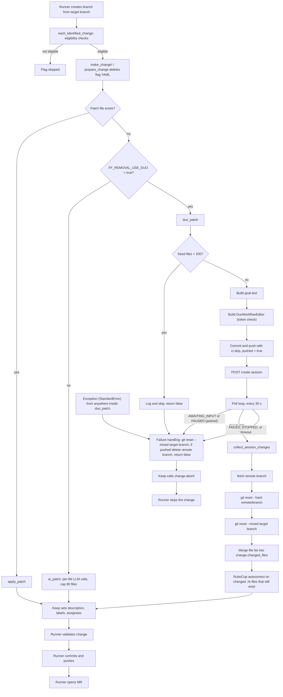
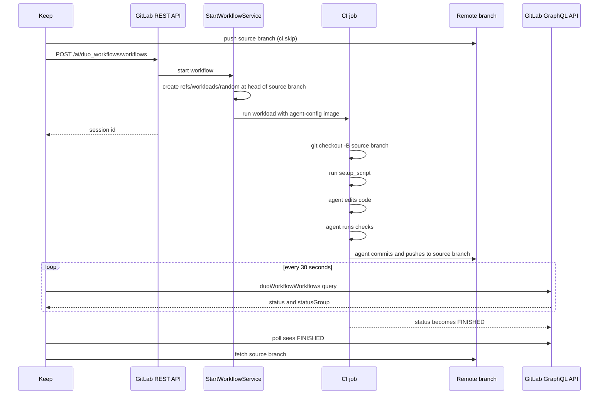
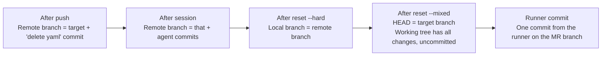

# Design: Feature flag removal through Duo Workflow

Design notes for the `Keeps::DeleteOldFeatureFlags` housekeeper keep and its Duo Agent Platform session path, introduced in merge request (MR) gitlab-org/gitlab!250444.

## Summary

The `Keeps::DeleteOldFeatureFlags` housekeeper keep removes old feature flags from the code base.

Before this MR, the keep patched one file at a time. It made one large language model (LLM) call per file.

After this MR, the keep can hand the whole job to one Duo Agent Platform session per feature flag. This document calls it a "flow session". The session runs in a continuous integration (CI) pipeline and has the full repository.

The session path is behind the environment switch `FF_REMOVAL_USE_DUO=true`. It is off by default, so a scheduled run still uses the per-file path until the session has been compared with it on real flags.

The keep still owns everything except editing code. The session only edits code.

## Background: what a keep is

`gitlab-housekeeper` is a gem in `gems/gitlab-housekeeper`. It runs "keeps". A keep is like a RuboCop cop. It does two things:

- It finds a change to make (`each_identified_change`).
- It makes the change (`make_change!`).

The runner (`Gitlab::Housekeeper::Runner`) turns the result into a commit and an MR. For each change, the runner does this:

1. Creates a branch from the target branch (default `master`).
2. Calls `keep.make_change!(change)`.
3. Validates the change. It needs identifiers, a title, a description, and `changed_files`.
4. Commits `change.changed_files` with `git add` and `git commit`.
5. Pushes with force to the `housekeeper` remote. It falls back to `origin`.
6. Opens or updates the MR.

A change can call `change.abort!`. The runner then skips it.

A dry run (the `-d` flag) still calls `make_change!`. It only skips opening the MR. Any side effect inside `make_change!` therefore also happens in a dry run.

## The per-file path (the current default)

The per-file path works in these steps:

1. Delete the flag's YAML definition file.
2. Run `git grep` for six patterns of the flag name: snake_case, lowerCamelCase, `Feature.enabled?`, `push_frontend_feature_flag`, `glFeatures`, and `gon`.
3. Cap the result at 80 files (`MAX_FILES_LIMIT`). If there are more, skip the flag.
4. For each file, pick a prompt by file extension from `keeps/prompts/remove_feature_flags.rb` (766 lines of per-language prompts).
5. Make one Anthropic API (application programming interface) call through `keeps/helpers/ai_editor.rb`.
6. Apply the returned old and new code blocks.
7. Run RuboCop autocorrect on that file.

The per-file path has these limits:

- Only files that literally contain the flag name can change.
- The model has no cross-file view.
- Dead code stays behind. Examples are HAML partials whose only render site was deleted, methods with no callers, unused imports, fixtures, and constants.
- The HAML prompt told the model to leave a note saying "the partial may no longer be needed". The model could not check.

## The new design

### Decisions at a glance

| # | Decision | Where |
|---|----------|-------|
| 1 | One repository-wide agent session per flag replaces N single-file LLM calls. | `keeps/delete_old_feature_flags.rb` |
| 2 | The keep keeps every responsibility the session should not own. | `keeps/delete_old_feature_flags.rb` |
| 3 | The handoff to the session goes through git. | `duo_patch` |
| 4 | The session is started and watched through public GitLab APIs. | `keeps/helpers/duo_workflow_editor.rb` |
| 5 | The platform runs the session as a CI workload on a ref built from the pushed branch. | GitLab platform |
| 6 | Prompts move into a playbook file the session reads on demand. | `keeps/prompts/remove_feature_flags/playbook.md` |
| 7 | The runner tells each keep its target branch. | `gems/gitlab-housekeeper` |
| 8 | Both paths stay, behind a switch that is off by default. | `keeps/delete_old_feature_flags.rb` |
| 9 | A separate digest script replaces the hand-written tracking note. | `scripts/feature_flags/post_removal_mr_digest.rb` |

### Decision 1: one repository-wide session per flag

One agent session replaces N single-file LLM calls.

Rationale: the session has the whole repository and a toolchain. It can run RuboCop, Prettier, RSpec, and Jest. It can therefore find and delete code that never mentions the flag.

### Decision 2: the keep owns everything except code edits

The keep keeps these responsibilities:

- Eligibility rules: milestone cutoffs, rollout issue labels, and the `intended_to_rollout_by` date.
- Branch naming.
- MR title and MR description.
- Labels and assignees.
- Changelog type.
- The "closed MR exists" guard.
- Abort handling.

The session only edits code.

### Decision 3: the handoff goes through git

The handoff lives in `duo_patch` in `keeps/delete_old_feature_flags.rb`.

Steps:

1. Delete the flag YAML file. `prepare_change` already did this.
2. Collect seed files with the same six `git grep` patterns. If there are more than 200 (`MAX_FILES_LIMIT_FOR_DUO`), log and skip the flag (return `false`).
3. Build the goal text with `Keeps::Prompts::RemoveFeatureFlags#goal`.
4. Build the `DuoWorkflowEditor`. This happens before any git operation, so a missing token fails before any branch is pushed.
5. Inside `git_helper.in_branch(branch_name)`:
   - Run `git add` on the changed files.
   - Run `git commit` with `change.commit_message`.
   - Push to the `housekeeper` remote with the push option `ci.skip`. The push itself starts no pipeline.
   - Set `pushed = true`.
6. Call `editor.run(goal:, source_branch: branch_name)`. Wait for it.
7. On success, call `collect_session_changes(branch_name)`:
   - `git_helper.remote_branch_changed_files(branch_name)` fetches the remote branch and diffs from the merge base with the target branch.
   - `git reset --hard <remote>/<branch>` loads the session's commits.
   - `git reset --mixed <target_branch>` unwinds all commits back into the working tree as uncommitted changes.
   - The file list is merged into `change.changed_files`.
   - `Shell.rubocop_autocorrect` runs on the `.rb` files in that list that still exist. Files the session deleted are skipped.
8. On failure, the keep cleans up. Failure means the session did not finish, or any `StandardError` was raised. The keep runs `git reset --mixed <target_branch>` to unwind the local commit made for the session. If `pushed` is true, the keep deletes the remote branch (`git push <remote> --delete <branch>`). It returns `false`. The keep then calls `change.abort!`. No MR is opened from a half-finished branch.

Rationales:

| Choice | Reason |
|--------|--------|
| Cap of 200 seed files | Repository-wide reach is the point, so the cap is higher than the old 80. Hundreds of files would still make an unreviewable MR. |
| Build the editor before touching git | A missing token must fail before any branch is pushed. |
| `git reset --mixed` instead of `--soft` | A soft reset leaves the deleted flag file staged and already gone from the working tree. The runner then runs `git add <that path>` and fails with "pathspec did not match any files". A mixed reset resets the index to the target branch. The deletion is present in the working tree but unstaged. This is the same state every other keep leaves. The runner stages and commits everything itself. |
| Autocorrect after the session | The goal asks the session to run RuboCop autocorrect, but only this step guarantees it. It keeps the session path at parity with the per-file path, which autocorrects after each edit. |
| Unwind the local commit on failure | Without it, the runner's abort path (`create_commit`) runs `git add` on a deletion that is already committed. That fails with "pathspec did not match any files" and aborts the whole batch. |
| Delete only what this run pushed | Branch names are deterministic per flag. The runner reuses an existing open MR. A failure before the push (for example a missing token on a re-run) must not delete the source branch of someone's open MR. |
| `rescue StandardError` | One flag failing must never abort the whole batch. There are too many ways the session call can raise to list them. |

### Decision 4: start and watch through public GitLab APIs

The code lives in `keeps/helpers/duo_workflow_editor.rb`.

#### Start

The editor sends `POST https://gitlab.com/api/v4/ai/duo_workflows/workflows`. The body has these fields:

| Field | Value |
|-------|-------|
| `project_id` | Default `gitlab-org/gitlab` (env `DUO_WORKFLOW_PROJECT_PATH`) |
| `goal` | The goal text |
| `workflow_definition` | `software_development` |
| `environment` | `ambient` (run in a CI pipeline, not an IDE) |
| `source_branch` | The pushed branch |
| `agent_privileges` | `[1, 4, 5, 8]` |
| `pre_approved_agent_privileges` | `[1, 4, 5, 8]` |
| `allow_agent_to_request_user` | `false` |
| `start_workflow` | `true` |

The `id` in the response body is the session id.

Privilege ids:

| Id | Privilege |
|----|-----------|
| 1 | Read and write files |
| 4 | Run commands |
| 5 | Use git |
| 8 | Read-only files |

The session is granted and pre-approved the same set. This keeps it non-interactive.

#### Poll

Every 30 seconds the editor sends `POST https://gitlab.com/api/graphql`. The query is:

```graphql
duoWorkflowWorkflows(workflowId: "gid://gitlab/Ai::DuoWorkflows::Workflow/<id>") {
  nodes { id status statusGroup }
}
```

#### Stop conditions

| Signal | Result |
|--------|--------|
| `statusGroup` is `AWAITING_INPUT` or `PAUSED` | Return `false` immediately. The session is parked and waits for a human (tool-call approval, plan approval, input, or a resume). |
| `status` is `FINISHED` | Return `true`. |
| `status` is `FAILED` or `STOPPED` | Return `false`. |
| Timeout | Return `false`. Default is 3600 seconds (env `DUO_WORKFLOW_TIMEOUT_SECONDS`). A non-positive or malformed value falls back to the default. |

#### Transient errors

A network exception or an unparsable body during a poll is logged. It is treated as "unknown, poll again". It is not treated as a session failure.

Rationale: an hour has about 120 polls, so a blip is likely. A poll failure is not a session failure.

#### No stop API

No public API exists to stop a session. A timed-out session may still push later. The keep deletes the branch on a failed handoff to neutralise that.

#### Token

The token comes from env `DUO_WORKFLOW_API_TOKEN`. It falls back to `HOUSEKEEPER_GITLAB_API_TOKEN`.

The token must have the `api` scope. The create call only accepts `api`. The narrower `ai_workflows` scope works for the GraphQL poll, but the create endpoint rejects it.

#### HTTP layer

The HTTP calls go through `Keeps::Helpers::GitlabApiHelper`. This MR added a `post` method and a `token:` constructor argument. Before, the helper always used the env var `GITLAB_QA_TEST_FAILURE_ISSUE_ACCESS_TOKEN`.

### Decision 5: what the platform does

This was verified against `ee/app/services/ai/duo_workflows/start_workflow_service.rb` and `app/services/ci/workloads/workload_branch_service.rb` on master.

- The create endpoint, with `start_workflow` set to `true`, runs `StartWorkflowService`.
- The service requires a project-level workflow. It requires the caller to have the `execute_duo_workflow_in_ci` ability. It requires a service account (composite identity) to be configured.
- The service creates an internal ref `refs/workloads/<random>`. The ref points at the head of `source_branch`.
- The service runs a CI workload (a pipeline job) on that ref. The job uses the image and `setup_script` from the project's `.gitlab/duo/agent-config.yml`.
- `gitlab-org/gitlab` has such a file. It names a Debian image with Ruby 3.3, Node 22, Go, and Python. The setup installs bubblewrap sandbox tooling, runs `bundle install` and `yarn install`, and installs lefthook hooks.
- The job's fixup commands run `git checkout -B "$DUO_WORKFLOW_SOURCE_BRANCH"`. The working copy is therefore on a local branch with the same name as the pushed branch. The agent's git pushes (privilege 5) go to that branch on the remote.
- This is why the keep can later fetch `<remote>/<branch>` and find the session's commits.
- The agent's commits are authored by the service account. They carry the human session owner as committer.

### Decision 6: prompts move into a playbook

`keeps/prompts/remove_feature_flags/playbook.md` (92 lines) holds the per-language rules for the session. The languages are Ruby, RSpec, HAML, Vue, JavaScript, Jest, and Markdown docs. The per-extension prompts used by the per-file path stay in `keeps/prompts/remove_feature_flags.rb` for now.

`Keeps::Prompts::RemoveFeatureFlags#goal` builds one goal. The goal contains:

- The flag name.
- Whether the flag is enabled or disabled in production, so the session knows which branch to keep.
- An instruction to read the playbook.
- The seed file list from `git grep`, with an explicit statement that the list is a starting point and not the boundary.
- An instruction to search for code that becomes dead and remove it.
- A version-history note to add to documentation.
- The check commands to run: `rubocop --autocorrect`, Prettier, RSpec, and Jest.
- The statement "the flag definition file is already deleted, do not delete it again, do not touch any other flag".

A spec asserts that the playbook path exists on disk. A rename cannot silently point the session at nothing.

### Decision 7: the runner tells each keep its target branch

This is a change to the gem.

- `Gitlab::Housekeeper::Keep#initialize` gained `target_branch: 'master'`.
- The runner passes its `--target-branch` value.
- The keep uses it for `git reset --mixed` and for the Git helper's `branch_from`.
- The one keep with an explicit constructor signature (`keeps/rspec_order_checker.rb`) was updated to accept and forward it. Every other keep forwards all arguments with `def initialize(...)`.
- `Gitlab::Housekeeper::Git#housekeeper_remote` became public. The keep runs fetch, reset, and delete against the same remote the gem pushes to.

Rationale: a separate env var could silently disagree with the runner's flag. The MR would then contain the whole diff between master and the real target.

### Decision 8: both paths stay, behind a switch

`apply_patch_or_ask_ai` picks the path for a flag:

1. A hand-written `.patch` file next to the flag YAML wins. It is applied with `git apply` (`apply_patch`).
2. Otherwise, if `FF_REMOVAL_USE_DUO` is `true`, the session path runs (`duo_patch`).
3. Otherwise the per-file path runs (`ai_patch`), with its cap of 80 files (`MAX_FILES_LIMIT`) and its RuboCop autocorrect after each edit.

Rationale: the session has not yet been run against real flags. The plan is to run both paths on a handful of flags, compare the MRs, then flip the default and delete the per-file prompts in a follow-up MR. An earlier revision of the MR removed the per-file path outright; that change was dropped so the security review of the session's privileges can happen before the default flips, not before this MR merges.

`keeps/helpers/ai_editor.rb` is also used by another keep (`MarkOldAdvancedSearchMigrationsAsObsolete`). This MR only adds the required `anthropic-version` header to its requests.

### Decision 9: a digest script

`scripts/feature_flags/post_removal_mr_digest.rb` replaces the hand-written tracking note.

The script does this:

1. Lists MRs in `gitlab-org/gitlab` labelled `automation:feature-flag-removal`, created in the last 7 days (env `FEATURE_FLAG_REMOVAL_LOOKBACK_DAYS`). It includes every state, so a quickly merged MR still appears once.
2. Skips any MR URL already present in a note on the tracking issue. The regex is anchored so `/merge_requests/1` is not matched by `/merge_requests/12`.
3. Posts one note listing the rest.

The tracking issue defaults to work item 597 in `gitlab-org/quality/engineering-productivity/team` (env `FEATURE_FLAG_REMOVAL_TRACKING_ISSUE_URL`). Group-level work item URLs are rejected.

The token is `FEATURE_FLAG_REMOVAL_API_TOKEN`. It falls back to `HOUSEKEEPER_GITLAB_API_TOKEN`.

Rationale: a script keeps the gem API unchanged. It produces one readable note instead of one note per MR.

The CI job that would run the script is not part of the MR.

## Diagrams

### Diagram 1: the keep run for one flag



### Diagram 2: the session side



### Diagram 3: git state at each step



## Environment variables

| Variable | Purpose |
|----------|---------|
| `FF_REMOVAL_USE_DUO` | `true` selects the session path. Default off. |
| `DUO_WORKFLOW_API_TOKEN` | Token with `api` scope and push access. Falls back to `HOUSEKEEPER_GITLAB_API_TOKEN`. |
| `DUO_WORKFLOW_TIMEOUT_SECONDS` | Per-session timeout. Default 3600. |
| `DUO_WORKFLOW_PROJECT_PATH` | Project that hosts the session. Default `gitlab-org/gitlab`. |
| `FEATURE_FLAG_REMOVAL_TRACKING_ISSUE_URL` | Tracking issue for the digest. |
| `FEATURE_FLAG_REMOVAL_API_TOKEN` | Token for posting the digest note. Falls back to `HOUSEKEEPER_GITLAB_API_TOKEN`. |
| `FEATURE_FLAG_REMOVAL_LOOKBACK_DAYS` | Digest window. Default 7. |
